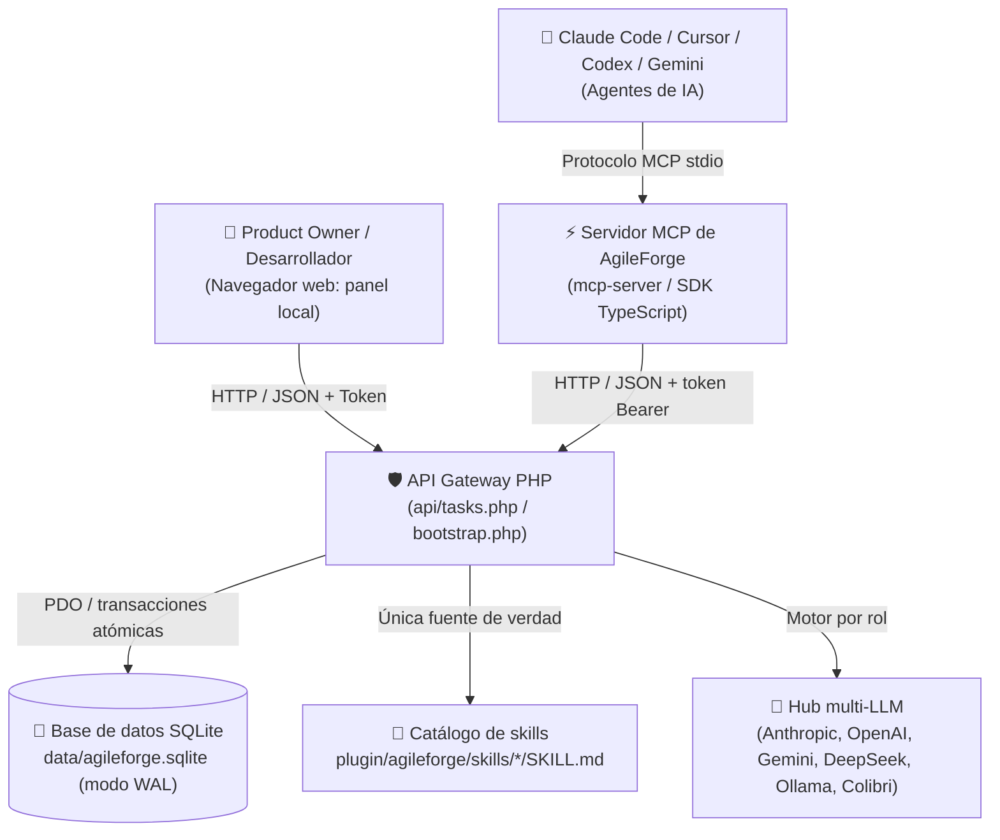
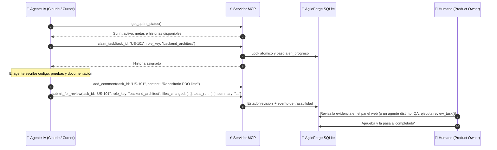

# 🚀 AgileForge v2 — Entorno de Trabajo Multi-Agente y Plugin MCP

🌐 [English](README.md) · **Español**

> **De un tablero de prompts estático a un equipo de ingeniería multi-agente autónomo.**
> AgileForge v2 permite que agentes de IA (**Claude Code, Cursor, Codex CLI, Gemini CLI**) y desarrolladores humanos trabajen sobre el mismo tablero Scrum en tiempo real, con persistencia transaccional en SQLite, herramientas MCP, un **Director General** que recibe tus instrucciones, gobernanza humana y auditorías honestas.

| 📖 Guía | English | Español |
|---|---|---|
| Guía de instalación | [INSTALL.md](INSTALL.md) | [INSTALL.es.md](INSTALL.es.md) |
| Manual para novatos | [BEGINNERS_GUIDE.md](BEGINNERS_GUIDE.md) | [MANUAL_NOVATOS.md](MANUAL_NOVATOS.md) |
| Claves de API (Claude, Gemini, OpenAI, DeepSeek) | [docs/API_KEYS.md](docs/API_KEYS.md) | [docs/API_KEYS.es.md](docs/API_KEYS.es.md) |
| Conectar Claude Code, Cursor, Codex, Gemini | [adapters/README.md](adapters/README.md) | [adapters/README.es.md](adapters/README.es.md) |
| Protocolo para agentes de IA | [adapters/AGENTS.md](adapters/AGENTS.md) | [adapters/AGENTS.es.md](adapters/AGENTS.es.md) |
| Cómo contribuir | [CONTRIBUTING.md](CONTRIBUTING.md) | [CONTRIBUTING.es.md](CONTRIBUTING.es.md) |

---

## 🏛️ Arquitectura



### Componentes clave
1. **Base de datos SQLite transaccional (`data/agileforge.sqlite`)**
   - Modo WAL, `busy_timeout`, transacciones `BEGIN IMMEDIATE` y cursores de vida corta, para que las llamadas largas a la IA nunca bloqueen la base de datos.
   - Tablas: `projects`, `sprints`, `roles`, `skills`, `role_skills`, `tasks`, `task_events`, `comments`, `meetings`, `meeting_turns`, `decisions`, `chat_messages`, `ai_token_usage`, `settings`.
2. **Seguridad**
   - Token criptográfico único en `.env`, que nunca se sirve por web (`Require all denied` en Apache) ni se sube al repositorio.
   - Verificación estricta de `Host` / `Origin` (`localhost`), `application/json` obligatorio, protección contra path traversal y escape contra XSS en todas las vistas.
   - Las claves de API viven solo en `.env`; el navegador solo ve una pista como `sk-ant-…a1b2`.
3. **Servidor MCP (`mcp-server/`)**
   - TypeScript con el SDK oficial `@modelcontextprotocol/sdk` (transporte `stdio`). Un solo código, dos bundles.
   - **Control** (completo): 21 herramientas validadas con `zod` (locks de tareas, entregas con evidencia, actas de reunión, ADR, sprints). **Vista** (solo lectura): 10 herramientas. Otras dos, `director_instruction` y `ask_agent`, solo se registran con `AGILEFORGE_ENGINE_TOOLS=on`.
   - Recursos URI nativos: `agileforge://sprint/current`, `agileforge://task/{id}`, `agileforge://roles`.
4. **Plugins oficiales para Claude Code (`plugin/agileforge/` y `plugin/agileforge-vista/`)**
   - **AgileForge Control:** 8 subagentes (**Director General**, Project Manager, Director Creativo, Arquitecto Jefe, Frontend Master, Backend Master, QA Sentinel y Asesor Legal), 27 skills en archivos `SKILL.md` reales, 7 comandos de barra y un hook `SessionStart` con resumen del sprint.
   - **AgileForge Vista:** solo lectura, con el agente `observador` y 5 comandos.
5. **Frontend web modular (módulos ES nativos)**
   - `app.js`, `state.js`, `ui.js`, `kanban.js`, `chat.js`, `meetings.js`, `director.js`, `bindings.js`, `skills.js`, `ux-lab.js`, `projects.js`, `legal.js`, `local-ai.js`, `i18n.js`.
   - Import map con cache-busting, 6 temas (día/noche), interfaz ES/EN y paleta global `Ctrl+K`.

---

## ⚡ Instalación

### 🤖 Instalación Asistida por IA
Copia y pega este mensaje en tu asistente (Claude Code, Cursor, Codex o Gemini):
> "Configura el entorno de desarrollo de AgileForge siguiendo estrictamente la guía `INSTALL.md`. Ejecuta la instalación, corre el diagnóstico con `npm run doctor` y confírmame cuando el servidor y el MCP estén listos para operar."

Consulta [INSTALL.es.md](INSTALL.es.md) (o [INSTALL.md](INSTALL.md)) para la guía canónica de instalación unificada.

### 1. Clona el repositorio
```bash
git clone https://github.com/JSOTELD/agile-forge.git
cd agile-forge
```

### 2. Crea la base de datos y el archivo `.env`
```bash
php bin/migrate.php
```
Crea `data/agileforge.sqlite` y un `.env` con un token local seguro. Solo agrega lo que falta; usa `php bin/migrate.php --force` únicamente para restaurar los datos de ejemplo de `data/team.json`.

### 3. Compila el servidor MCP
```bash
cd mcp-server
npm install
npm run build
cd ..
```

### 4. Sirve la aplicación
- **XAMPP / Apache:** pon la carpeta en `htdocs/` y abre `http://localhost/<carpeta>/` (por ejemplo `http://localhost/Open-to-code/`).
- **Servidor interno de PHP:**
  ```bash
  php -S localhost:8080 router.php   # el 8000 lo usa Colibri
  ```
  > **Pasa siempre `router.php`.** El servidor interno de PHP ignora los `.htaccess`: sin él, `/.env` (tus tokens y claves de API) y `/data/*.sqlite` (toda la base de datos) se podrían descargar. `router.php` responde 404 a esos archivos (y a `.git`, `bin/`, `config/`, `mcp-server/`, `*.log`) y además habilita las URL limpias `api/<ruta>`.

### 5. (Opcional) Conecta una IA
- **Modelos en la nube:** pega tus claves en **⚙️ Motor IA → 🔑 Claves de API**. Paso a paso: [docs/API_KEYS.es.md](docs/API_KEYS.es.md).
- **IA local:** instala [Ollama](https://ollama.com) o Colibri y activa el interruptor **🦙 IA local** (ver más abajo).
- **Sin claves de IA:** trabaja con los agentes desde Claude Code con el plugin (modo plugin).

---

## 🔌 Plugins de Claude Code: AgileForge Control y AgileForge Vista

Este repositorio es también un **marketplace** de Claude Code (`.claude-plugin/marketplace.json`) con dos plugins autocontenidos. El cerebro es Claude Code, así que **ambos funcionan sin claves de API y sin IA local**.

| Plugin | Qué es | Herramientas MCP | Detalles |
|---|---|---|---|
| **AgileForge Control** (`agileforge`) | El equipo completo de agentes: Director, especialistas, historias con lock, revisiones de QA, reuniones, decisiones y sprints. | 21 | [plugin/agileforge/README.es.md](plugin/agileforge/README.es.md) |
| **AgileForge Vista** (`agileforge-vista`, en inglés *AgileForge View*) | Solo lectura: sprint, columnas, quién hace qué, reuniones, decisiones y actividad. No puede cambiar nada. | 10 | [plugin/agileforge-vista/README.es.md](plugin/agileforge-vista/README.es.md) |

### Instalación

Desde GitHub:

```text
/plugin marketplace add JSOTELD/agile-forge
/plugin install agileforge@agileforge          # Control
/plugin install agileforge-vista@agileforge    # Vista (en lugar de Control)
```

Desde un clon local (la carpeta que contiene `.claude-plugin/marketplace.json`):

```text
/plugin marketplace add <ruta-a-agile-forge>
/plugin install agileforge@agileforge
```

Después ejecuta `/reload-plugins` o abre una sesión nueva. La web de AgileForge debe estar en marcha (PHP 8.2, p. ej. XAMPP) y Node.js 18+ debe estar en tu `PATH`.

**Control y Vista son excluyentes: instala solo uno.** Para cambiar, desinstala primero el otro (`/plugin uninstall agileforge-vista@agileforge`, o `agileforge@agileforge`).

El servidor MCP encuentra solo la URL y el token de la API (variables de entorno, `$AGILEFORGE_HOME/.env`, un `.env` hacia arriba desde tu proyecto o `~/.agileforge/config.json`). Pídele a Claude "ejecuta connection_info" para ver qué está usando (nunca muestra el token). Orden completo de búsqueda: en los README de cada plugin, enlazados arriba.

### Agentes, modelo y esfuerzo (ADR-003)

Cada agente tiene su propio modelo y esfuerzo, para usar el modelo caro solo donde compensa:

| agente | modelo | esfuerzo |
|---|---|---|
| director | opus | high |
| chief-architect | opus | high |
| qa-security | sonnet | high |
| backend | sonnet | medium |
| frontend | sonnet | medium |
| creative-director | sonnet | low |
| legal-compliance | sonnet | low |
| project-manager | haiku | low |
| observador (Vista) | haiku | low |

### Comandos

- **Control:** `/agileforge:sprint`, `/agileforge:daily`, `/agileforge:tomar <US-id>`, `/agileforge:dod <US-id>`, `/agileforge:reunion <tipo> <tema>`, `/agileforge:director <instrucción>`, `/agileforge:equipo`.
- **Vista:** `/agileforge-vista:estado`, `/agileforge-vista:tablero`, `/agileforge-vista:reuniones`, `/agileforge-vista:decisiones`, `/agileforge-vista:actividad`.

### Gobernanza: quién puede completar una historia

- Los agentes toman una historia con `claim_task` (lock atómico) y entregan con evidencia (`submit_for_review`).
- Una historia llega a `completada` solo de dos maneras: un **humano** la aprueba en la web, o el **rol QA** (`qa_security_guard`) la aprueba con `review_task`, siempre que la historia esté en revisión, tenga evidencia y el revisor **no** sea el agente que la tomó.
- Cualquier otro intento se rechaza con un mensaje claro (403/409). El Director General tampoco puede completar historias.
- El lock se libera al completar la historia o devolverla al backlog; `request_changes` la devuelve a en progreso y mantiene el lock del desarrollador.

---

## 👁️ Página web de vista (`vista.php`)

`vista.php` es una página de solo lectura con el estado del tablero: sprint, avance, quién trabaja en qué, reuniones, decisiones y actividad. Ábrela con el botón **👁️ Vista** de la barra superior de la app (se abre en otra pestaña) o directamente en `http://localhost/<carpeta>/vista.php`.

- Usa solo el token de solo lectura (nunca el principal), así que no puede cambiar nada.
- Está pensada para quien solo quiere seguir el avance: patrocinadores, clientes, compañeros.
- Lee los mismos datos que el plugin AgileForge Vista (`GET /overview` y similares).

---

## 🔒 Token de solo lectura (`AGILEFORGE_VIEW_TOKEN`)

| Token | Variable en `.env` | Permite | Lo usan |
|---|---|---|---|
| Principal | `AGILEFORGE_API_TOKEN` | Todo (lectura y escritura) | La web, el plugin Control, Cursor/Codex/Gemini |
| Solo lectura | `AGILEFORGE_VIEW_TOKEN` | Solo `GET` en `api/index.php` y solo en `overview`, `events`, `meetings[/{id}]`, `decisions`, `tasks[/{id}]`, `sprint/status` y `roles/{id}/brief` (el resto, p. ej. `/state`, `/skills`, `/roles`: `403`) | `vista.php`, el plugin Vista, el modo lector del servidor MCP |

- Ambos se generan solos (con `php bin/migrate.php` o en el primer arranque) si están vacíos.
- `api/tasks.php` y cualquier escritura rechazan el token de solo lectura con `403`: aunque se filtre, no puede modificar el tablero.
- Para que alguien mire sin poder tocar nada, comparte solo `AGILEFORGE_VIEW_TOKEN`. **Nunca** compartas el token principal.
- Ambos viven solo en `.env` (nunca se suben a Git). Para rotar uno, borra su valor y recarga la app para que genere uno nuevo.

---

## 👑 Director General (jefe máximo) y motores por rol

- **Director General** (`director`): dale una instrucción desde el panel del tablero, desde el chat o con la herramienta MCP `director_instruction`. Revisa el tablero, decide, delega en los especialistas (crea, reasigna y reprioriza historias), consulta a los agentes, registra ADR y ajusta el sprint, y te rinde cuentas con **Decisión / Qué hice / Siguientes pasos / Riesgos**. Nunca marca historias como completadas: eso lo apruebas tú.
- Con Claude usa *tool use* nativo de la Messages API; con cualquier otro motor (IA local, OpenAI, Gemini, DeepSeek) usa un protocolo JSON equivalente. Responde en el idioma en que le escribes.
- **Motor por rol:** en **🤖 Equipo de Agentes** cada rol tiene un selector: un modelo de API, la **IA local activa** o *Heredar*. Si al rol le falta su clave, responde la IA local o el motor global, y la tarjeta lo indica. Detalles: [docs/API_KEYS.es.md](docs/API_KEYS.es.md#4-elige-qué-modelo-usa-cada-rol).
- **Reuniones:** cada agente interviene con su propio motor, un turno por petición (así nada se corta por tiempo), y el Director redacta la resolución y los acuerdos. Si no hay motor, se informa; nunca se inventan respuestas.

---

## 👨‍💻 Uso (Product Owner / Líder Técnico)

1. **Proyectos y workspaces:** alterna entre proyectos aislados (cada uno con su sprint y backlog). **Importar Workspace** lee una carpeta o repositorio Git y propone un backlog inicial a partir de los últimos commits.
2. **Tablero Scrum:** *Backlog*, *En Progreso*, *En Revisión (DoD)* y *Completadas*, con filtros combinables (texto, agente, prioridad, skill). Haz clic en una historia para editarla, copiar su prompt de misión o de auditoría DoD, pedirle una decisión al Director o eliminarla.
3. **Gobernanza:** ningún agente puede pasar una historia a *Completada*; eso requiere tu aprobación o la del rol QA, y QA nunca puede aprobar un trabajo que tomó él mismo (ver [Gobernanza](#gobernanza-quién-puede-completar-una-historia)).
4. **Laboratorio UX/UI:** inspección en vivo del DOM (imágenes sin `alt`, campos sin etiqueta, contraste), análisis del viewport y checklist de las 10 heurísticas de Nielsen guardado en SQLite. Sin certificaciones falsas.
5. **Sala de reuniones:** brainstorming, consejo de arquitectura (ADR), compliance o daily; convierte los acuerdos en historias del backlog con un clic.
6. **Inversión IA:** haz clic en **Inversión IA** en el banner del sprint para ver llamadas, tokens y costo estimado por agente (precios de `config/models.json`).

---

## 🤖 Uso desde agentes de IA

### Claude Code (plugins)
Instala **AgileForge Control** (o **AgileForge Vista** para solo lectura) como se explica en [Plugins de Claude Code](#-plugins-de-claude-code-agileforge-control-y-agileforge-vista):
```text
/plugin marketplace add JSOTELD/agile-forge
/plugin install agileforge@agileforge
```
```text
/agileforge:director prioriza las reservas online para esta semana   # El Director decide y delega
/agileforge:sprint            # Estado del sprint, puntos y bloqueos
/agileforge:tomar US-101      # Toma la historia (lock atómico) y la pasa a en progreso
/agileforge:dod US-101        # Consulta la Definition of Done
/agileforge:reunion adr "Persistencia en SQLite"   # Convoca un debate entre agentes
/agileforge:equipo            # Agentes con modelo, esfuerzo y especialidad
```

### Cursor, Codex CLI, Gemini CLI
AgileForge expone un servidor MCP estándar por `stdio` (`mcp-server/dist/index.js`; compílalo antes con `npm run build`). Configuraciones listas: [`adapters/cursor.json`](adapters/cursor.json), [`adapters/codex.json`](adapters/codex.json), [`adapters/gemini.json`](adapters/gemini.json). Guía completa: [adapters/README.es.md](adapters/README.es.md). Para una conexión de solo lectura usa `mcp-server/dist/viewer.js`.

```json
{
  "mcpServers": {
    "agileforge": {
      "command": "node",
      "args": ["<ruta-a-agile-forge>/mcp-server/dist/index.js"],
      "env": { "AGILEFORGE_API_URL": "http://localhost/<carpeta>/api" }
    }
  }
}
```

### Flujo de trabajo de los agentes



### Herramientas MCP

**Control** expone 21 herramientas; **Vista** solo las 10 de lectura (marcadas con 👁️). Los nombres son los mismos en ambos; los plugins les añaden un prefijo (`mcp__plugin_agileforge_board__<herramienta>`, `mcp__plugin_agileforge-vista_board__<herramienta>`).

| Herramienta | Descripción | Parámetros clave |
| :--- | :--- | :--- |
| 👁️ `get_overview` | Foto compacta: sprint, columnas, historias, quién trabaja, reuniones, decisiones y eventos. | `project` |
| 👁️ `get_sprint_status` | Sprint activo, días restantes, velocidad, puntos por columna y bloqueos. | — |
| 👁️ `list_tasks` | Lista historias con filtros combinados (compacto por defecto). | `status`, `role`, `priority`, `project_id` |
| 👁️ `get_task` | Detalle completo: DoD, skills, prompts, comentarios y eventos. | `task_id` |
| 👁️ `list_meetings` | Últimas reuniones (opcionalmente compactas). | `limit`, `compact` |
| 👁️ `get_meeting` | Una reunión con todos sus turnos. | `meeting_id` |
| 👁️ `list_decisions` | Últimas decisiones (ADR). | `limit` |
| 👁️ `get_activity` | Eventos recientes del tablero. | `limit` |
| 👁️ `get_role_brief` | Devuelve el system prompt del rol, sus skills activas y la normativa legal. | `role_id` |
| 👁️ `connection_info` | URL usada, modo y origen de la configuración (nunca el token). | — |
| `create_task` | Descompone el trabajo en historias del backlog. | `title`, `assigned_to`, `story_points`, `user_story`, `dod` |
| `claim_task` | Toma una historia con lock atómico. | `task_id`, `role_key` |
| `update_task_status` | Cambia el estado de una historia con nota de avance. | `task_id`, `status`, `note`, `role_key` |
| `add_comment` | Registra avance técnico o dudas. | `task_id`, `role`, `content` |
| `submit_for_review` | Pasa una historia a revisión con evidencia de pruebas y diffs. | `task_id`, `role_key`, `files_changed`, `tests_run`, `summary` |
| `review_task` | Aprueba o pide cambios (solo QA / PO, nunca el autor). | `task_id`, `decision`, `checklist`, `reviewer_role` |
| `start_meeting` | Abre un debate (brainstorming, ADR, compliance, daily). | `meeting_type`, `topic`, `participants` |
| `add_meeting_turn` | Registra la intervención argumentada de un rol. | `meeting_id`, `role_id`, `statement` |
| `close_meeting` | Cierra la reunión con acta, resolución y acuerdos. | `meeting_id`, `summary`, `resolution`, `action_items` |
| `record_decision` | Registra un Architectural Decision Record (ADR). | `title`, `context`, `decision`, `consequences` |
| `start_sprint` | Inicia un sprint activo nuevo y cierra el anterior. | `name`, `goal`, `days_remaining`, `velocity_points`, `project_id` |
| `director_instruction` | *Opcional* (`AGILEFORGE_ENGINE_TOOLS=on`): envía una instrucción al Director General mediante el motor web. | `instruction` |
| `ask_agent` | *Opcional* (`AGILEFORGE_ENGINE_TOOLS=on`): consulta a un agente con el motor asignado a su rol. | `role_id`, `message` |

Las dos herramientas opcionales usan el motor de IA de la web, así que necesitan una clave de proveedor o una IA local.

---

## ⚙️ Entorno (`.env`)

```ini
# Token local de la API (lo genera bin/migrate.php)
AGILEFORGE_API_TOKEN=tu_token_sha256
# Token de solo lectura (solo GET): lo usan vista.php y el plugin Vista
AGILEFORGE_VIEW_TOKEN=tu_token_de_solo_lectura
AGILEFORGE_DB_PATH=data/agileforge.sqlite
AGILEFORGE_ENV=local

# MCP / plugin (opcional): solo si la app no está en http://localhost/Open-to-code/api
# AGILEFORGE_API_URL=http://localhost/<carpeta>/api
# AGILEFORGE_ENGINE_TOOLS=on   # registra también director_instruction y ask_agent

# Claves de API opcionales, solo para el modo API en el servidor (no hacen falta con los plugins)
# (también puedes pegarlas en Motor IA → Claves de API)
ANTHROPIC_API_KEY=
ANTHROPIC_WORKSPACE_ID=   # solo si tu clave de Claude no está asociada a un workspace
OPENAI_API_KEY=
GEMINI_API_KEY=
DEEPSEEK_API_KEY=
```

Cómo conseguir cada clave y cuánto cuesta: [docs/API_KEYS.es.md](docs/API_KEYS.es.md).

---

## 🦙 IA local (Ollama y Colibri)

AgileForge detecta si hay una IA local en tu PC y te deja activarla o desactivarla con un clic.

- **Interruptor 🦙 IA local** en la barra superior: muestra *No detectada*, *Apagada* o el modelo activo.
- **Motor IA → IA local en esta PC:** elige el modelo, vuelve a detectar y haz una prueba rápida (muestra tokens/s).
- **Cuando está activada**, los roles sin motor de API propio responden con el modelo local. Nada sale de tu PC y el costo registrado es 0.
- Motores soportados:
  - **Ollama** (`127.0.0.1:11434`, u `OLLAMA_HOST`).
  - **Colibri** (`127.0.0.1:8000`, o `COLIBRI_HOST`): motor para modelos MoE grandes que guarda los expertos más usados en GPU/RAM y lee el resto del NVMe. API compatible con OpenAI.
  - LM Studio (`127.0.0.1:1234`) se detecta solo como información.
- Acciones de la API: `detect_local_ai`, `toggle_local_ai`, `update_local_ai`, `update_local_ai_settings`, `test_local_ai`.

Ejemplo de configuración (RTX 3050 8 GB + 64 GB de RAM):

| Motor | Modelo | Velocidad medida | Memoria | Uso |
|---|---|---|---|---|
| Ollama | `gemma4:e4b` | ~80 tokens/s | ~6 GB de VRAM | Rápido, para el día a día |
| Ollama | `gemma4:26b` | ~21 tokens/s | ~19 GB de RAM | Más calidad, ocupa mucha RAM |
| Colibri | `qwen3.6-colibri` (Qwen3.6-35B-A3B) | ~10 tokens/s | ≤12 GB RAM, 2,5 GB VRAM | La mejor calidad sin quitarle memoria a tu trabajo |

### Colibri en Windows
- `bin\colibri-instalar.cmd`: descarga una versión fija de Colibri, el motor CUDA y el modelo Qwen3.6-35B-A3B (23 GB) y lo deja corriendo en segundo plano.
- `bin\colibri-iniciar.cmd` / `bin\colibri-detener.cmd`: iniciarlo otro día o liberar la memoria.
- `bin\colibri-crear-acceso-directo.cmd`: crea el acceso directo **"Colibri IA"** en el escritorio, que enciende Colibri en su propia ventana y lo apaga al cerrarla (salvo que AgileForge lo esté usando).
- **Motor IA → "Permitir que AgileForge encienda y apague Colibri"**: con ese permiso y la IA local activada, AgileForge enciende Colibri cuando lo necesita y lo apaga al desactivar la IA local.
- Límites de memoria en `%LOCALAPPDATA%\colibri\setup.json` (`--ram 12 --vram 2.5 --ctx 16384`). Ruta configurable en `config/local-ai.json` (`colibri_home`).

---

## 🧪 Verificación

```bash
find . -name "*.php" ! -path "./mcp-server/*" -exec php -l {} +   # Sintaxis PHP
php bin/migrate.php                                                  # Migración idempotente
for f in assets/js/*.js; do node --check "$f"; done                  # Módulos ES
cd mcp-server && npm ci && npm run check && npm run build && cd ..   # Servidor MCP
cd mcp-server && npm run bundle && cd ..                             # bundles de los plugins (súbelos al repo)
claude plugin validate .                                             # marketplace y plugins
```

Detalles en [CONTRIBUTING.es.md](CONTRIBUTING.es.md).

Los errores del servidor se registran en `data/logs/agileforge.log` (no se sirve por web ni se sube al repositorio).

---

## ⚠️ Notices / Avisos

- **Los costos de API de terceros corren por tu cuenta.** Si agregas claves de Anthropic, OpenAI, Google o DeepSeek, esos proveedores te facturan directamente. AgileForge solo muestra una estimación del costo.
- **Las claves viven solo en `.env`.** Nunca se guardan en la base de datos, los logs, el navegador ni Git. No las compartas ni las subas al repositorio.
- **El modo plugin usa tu plan de Claude Code.** Todo el trabajo de los agentes a través de los plugins consume tu propio plan o cuota de Claude Code; Opus con esfuerzo alto es lo que más cuesta.
- **No es asesoría profesional.** Los agentes, incluido Legal y Compliance, ofrecen orientación y **no sustituyen** a un abogado, contador u otro profesional calificado. Revisa siempre lo que producen.
- **Tal cual.** El software se entrega "tal cual", sin garantía de ningún tipo, bajo la [licencia MIT](LICENSE).
- **Sin afiliación.** AgileForge es un proyecto independiente y no está afiliado, respaldado ni patrocinado por Anthropic, Google, OpenAI ni DeepSeek. Los nombres de productos y empresas pertenecen a sus dueños.

---

## 📜 Estándares
- **Metodología:** Agile Scrum + PMBOK 7.ª edición.
- **Diseño:** Nielsen Norman Group (10 heurísticas de usabilidad), WCAG 2.2 AA.
- **Seguridad:** OWASP API Security Top 10.
- **Licencia:** ver [LICENSE](LICENSE).
