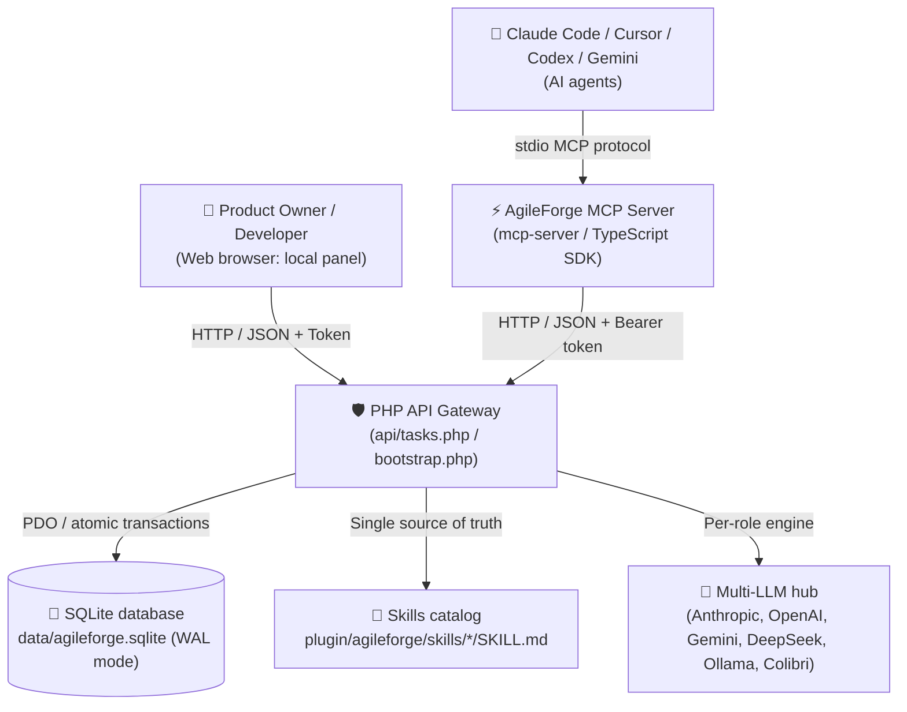
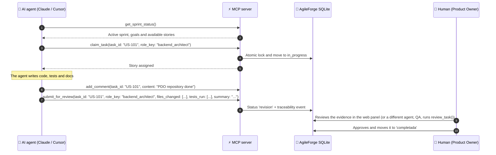

# 🚀 AgileForge v2 — Multi-Agent Workspace & MCP Plugin

🌐 **English** · [Español](README.es.md)

> **From a static prompt board to an autonomous multi-agent engineering team.**
> AgileForge v2 lets AI agents (**Claude Code, Cursor, Codex CLI, Gemini CLI**) and human developers work on the same Scrum board in real time, with transactional SQLite storage, MCP tools, a **Managing Director agent** that takes your instructions, human governance and honest audits.

| 📖 Guide | English | Español |
|---|---|---|
| Beginner's guide | [BEGINNERS_GUIDE.md](BEGINNERS_GUIDE.md) | [MANUAL_NOVATOS.md](MANUAL_NOVATOS.md) |
| API keys (Claude, Gemini, OpenAI, DeepSeek) | [docs/API_KEYS.md](docs/API_KEYS.md) | [docs/API_KEYS.es.md](docs/API_KEYS.es.md) |
| Connecting Claude Code, Cursor, Codex, Gemini | [adapters/README.md](adapters/README.md) | [adapters/README.es.md](adapters/README.es.md) |
| Protocol for AI agents | [adapters/AGENTS.md](adapters/AGENTS.md) | [adapters/AGENTS.es.md](adapters/AGENTS.es.md) |
| Contributing | [CONTRIBUTING.md](CONTRIBUTING.md) | [CONTRIBUTING.es.md](CONTRIBUTING.es.md) |

---

## 🏛️ Architecture



### Key components
1. **Transactional SQLite database (`data/agileforge.sqlite`)**
   - WAL mode, `busy_timeout`, `BEGIN IMMEDIATE` transactions and short-lived cursors, so long AI calls never lock the database.
   - Tables: `projects`, `sprints`, `roles`, `skills`, `role_skills`, `tasks`, `task_events`, `comments`, `meetings`, `meeting_turns`, `decisions`, `chat_messages`, `ai_token_usage`, `settings`.
2. **Security**
   - Unique cryptographic token in `.env`, which is never served (`Require all denied` in Apache) and never committed.
   - Strict `Host` / `Origin` checks (`localhost`), forced `application/json`, path-traversal protection, XSS escaping in every view.
   - API keys live only in `.env`; the browser only ever sees a hint such as `sk-ant-…a1b2`.
3. **MCP server (`mcp-server/`)**
   - TypeScript with the official `@modelcontextprotocol/sdk` (`stdio` transport). One codebase, two bundles.
   - **Control** (full): 21 `zod`-validated tools (task locks, evidence-based delivery, meeting minutes, ADRs, sprints). **View** (read-only): 10 tools. Two more tools, `director_instruction` and `ask_agent`, are registered only with `AGILEFORGE_ENGINE_TOOLS=on`.
   - Native URI resources: `agileforge://sprint/current`, `agileforge://task/{id}`, `agileforge://roles`.
4. **Official Claude Code plugins (`plugin/agileforge/` and `plugin/agileforge-vista/`)**
   - **AgileForge Control:** 8 sub-agents (**Managing Director**, Project Manager, Creative Director, Chief Architect, Frontend Master, Backend Master, QA Sentinel, Legal Counsel), 27 skills in real `SKILL.md` files, 7 slash commands and a `SessionStart` hook with a sprint summary.
   - **AgileForge View:** read-only, with the `observador` agent and 5 commands.
5. **Modular web frontend (native ES modules)**
   - `app.js`, `state.js`, `ui.js`, `kanban.js`, `chat.js`, `meetings.js`, `director.js`, `bindings.js`, `skills.js`, `ux-lab.js`, `projects.js`, `legal.js`, `local-ai.js`, `i18n.js`.
   - Import map with cache busting, 6 themes (day/night), ES/EN interface and a global `Ctrl+K` palette.

---

## ⚡ Installation

### 1. Clone the repository
```bash
git clone https://github.com/JSOTELD/agile-forge.git
cd agile-forge
```

### 2. Create the database and the `.env` file
```bash
php bin/migrate.php
```
This creates `data/agileforge.sqlite` and a `.env` with a secure local token. It only adds missing data; use `php bin/migrate.php --force` only to restore the sample data from `data/team.json`.

### 3. Build the MCP server
```bash
cd mcp-server
npm install
npm run build
cd ..
```

### 4. Serve the app
- **XAMPP / Apache:** put the folder in `htdocs/` and open `http://localhost/<folder>/` (for example `http://localhost/Open-to-code/`).
- **PHP built-in server:**
  ```bash
  php -S localhost:8080 router.php   # 8000 is used by Colibri
  ```
  > **Always pass `router.php`.** PHP's built-in server ignores `.htaccess`, so without it `/.env` (your tokens and API keys) and `/data/*.sqlite` (the whole database) would be downloadable. `router.php` answers 404 for them (and for `.git`, `bin/`, `config/`, `mcp-server/`, `*.log`) and also gives you the clean `api/<route>` URLs.

### 5. (Optional) Connect an AI
- **Cloud models:** paste your keys in **⚙️ AI Engine → 🔑 API keys**. Step by step: [docs/API_KEYS.md](docs/API_KEYS.md).
- **Local AI:** install [Ollama](https://ollama.com) or Colibri and turn on the **🦙 Local AI** switch (see below).
- **Without AI keys:** work with the agents from Claude Code through the plugin (plugin mode).

---

## 🔌 Claude Code plugins: AgileForge Control & AgileForge View

This repository is also a Claude Code **marketplace** (`.claude-plugin/marketplace.json`) with two self-contained plugins. Claude Code is the brain, so **both work without API keys and without a local AI**.

| Plugin | What it is | MCP tools | Details |
|---|---|---|---|
| **AgileForge Control** (`agileforge`) | The full agent team: Director, specialists, locked stories, QA reviews, meetings, decisions and sprints. | 21 | [plugin/agileforge/README.md](plugin/agileforge/README.md) |
| **AgileForge View** (`agileforge-vista`) | Read-only: sprint, columns, who does what, meetings, decisions and activity. It cannot change anything. | 10 | [plugin/agileforge-vista/README.md](plugin/agileforge-vista/README.md) |

### Install

From GitHub:

```text
/plugin marketplace add JSOTELD/agile-forge
/plugin install agileforge@agileforge          # Control
/plugin install agileforge-vista@agileforge    # View (instead of Control)
```

From a local clone (the folder that holds `.claude-plugin/marketplace.json`):

```text
/plugin marketplace add <path-to-agile-forge>
/plugin install agileforge@agileforge
```

Then run `/reload-plugins` or start a new session. The AgileForge web app must be running (PHP 8.2, e.g. XAMPP) and Node.js 18+ must be on your `PATH`.

**Control and View are mutually exclusive: install only one.** To switch, uninstall the other first (`/plugin uninstall agileforge-vista@agileforge`, or `agileforge@agileforge`).

The MCP server finds the API URL and token on its own (environment variables, `$AGILEFORGE_HOME/.env`, a `.env` found upwards from your project, or `~/.agileforge/config.json`). Ask Claude to "run connection_info" to see what it is using (it never shows the token). Full lookup order: the plugin READMEs linked above.

### Agents, model and effort (ADR-003)

Each agent has its own model and effort, so the expensive model is used only where it pays off:

| agent | model | effort |
|---|---|---|
| director | opus | high |
| chief-architect | opus | high |
| qa-security | sonnet | high |
| backend | sonnet | medium |
| frontend | sonnet | medium |
| creative-director | sonnet | low |
| legal-compliance | sonnet | low |
| project-manager | haiku | low |
| observador (View) | haiku | low |

### Commands

- **Control:** `/agileforge:sprint`, `/agileforge:daily`, `/agileforge:tomar <US-id>`, `/agileforge:dod <US-id>`, `/agileforge:reunion <type> <topic>`, `/agileforge:director <instruction>`, `/agileforge:equipo`.
- **View:** `/agileforge-vista:estado`, `/agileforge-vista:tablero`, `/agileforge-vista:reuniones`, `/agileforge-vista:decisiones`, `/agileforge-vista:actividad`.

### Governance: who can complete a story

- Agents take a story with `claim_task` (atomic lock) and deliver with evidence (`submit_for_review`).
- A story reaches `completada` (done) in only two ways: a **human** approves it in the web app, or the **QA role** (`qa_security_guard`) approves it with `review_task`, provided the story is in review, has evidence and the reviewer is **not** the agent that claimed it.
- Anything else is rejected with a clear 403/409 message. The Managing Director cannot complete stories either.
- The lock is released when the story is completed or goes back to the backlog; `request_changes` returns it to in progress and keeps the developer's lock.

---

## 👁️ Web view page (`vista.php`)

`vista.php` is a read-only page with the state of the board: sprint, progress, who is working on what, meetings, decisions and activity. Open it from the **👁️ View** button in the top bar of the app (it opens in a new tab) or directly at `http://localhost/<folder>/vista.php`.

- It only uses the read-only token (never the main one), so it cannot change anything.
- It is meant for people who just want to follow progress: sponsors, clients, teammates.
- It reads the same data as the AgileForge View plugin (`GET /overview` and friends).

---

## 🔒 Read-only token (`AGILEFORGE_VIEW_TOKEN`)

| Token | Variable in `.env` | Allows | Used by |
|---|---|---|---|
| Main | `AGILEFORGE_API_TOKEN` | Everything (read and write) | Web app, Control plugin, Cursor/Codex/Gemini |
| Read-only | `AGILEFORGE_VIEW_TOKEN` | Only `GET` on `api/index.php`, and only on `overview`, `events`, `meetings[/{id}]`, `decisions`, `tasks[/{id}]`, `sprint/status` and `roles/{id}/brief` (anything else, e.g. `/state`, `/skills`, `/roles`: `403`) | `vista.php`, View plugin, viewer mode of the MCP server |

- Both are generated automatically (by `php bin/migrate.php` or on first run) if they are empty.
- `api/tasks.php` and any write reject the read-only token with `403`, so even if it leaks it cannot change the board.
- To let someone watch without touching anything, share only `AGILEFORGE_VIEW_TOKEN`. **Never** share the main token.
- Both live only in `.env` (never committed). To rotate one, clear its value and reload the app so it generates a new one.

---

## 👑 The Managing Director (team lead) and per-role engines

- **Managing Director** (`director`): give it an instruction from the panel on the board, from the chat or with the MCP tool `director_instruction`. It reviews the board, decides, delegates to the specialists (creates, reassigns and re-prioritizes stories), consults agents, records ADRs and adjusts the sprint, then reports back with **Decision / What I did / Next steps / Risks**. It never marks stories as done: you approve that.
- With Claude it uses native **tool use** of the Messages API; with any other engine (local AI, OpenAI, Gemini, DeepSeek) it uses an equivalent JSON protocol. It answers in the language you write in.
- **Per-role engine:** in **🤖 Agent Team** every role has a selector: an API model, the **active local AI** or *Inherit*. If a role's key is missing, it falls back to the local AI or the global engine, and the card tells you so. Details: [docs/API_KEYS.md](docs/API_KEYS.md#4-choose-which-model-each-role-uses).
- **Meetings:** each agent speaks with its own engine, one turn per request (so nothing times out), and the Director writes the resolution and agreements. If there is no engine, the app says so; it never makes up answers.

---

## 👨‍💻 Using it (Product Owner / Tech Lead)

1. **Projects and workspaces:** switch between isolated projects (each with its own sprint and backlog). **Import Workspace** reads a folder or Git repo and drafts an initial backlog from recent commits.
2. **Scrum board:** *Backlog*, *In Progress*, *DoD Review* and *Done*, with combinable filters (text, agent, priority, skill). Click a story to edit it, copy its mission prompt or its DoD audit prompt, ask the Director to decide, or delete it.
3. **Governance:** no agent can move a story to *Done*; that needs your approval or the QA role, and QA can never approve work it claimed itself (see [Governance](#governance-who-can-complete-a-story)).
4. **UX/UI Lab:** live DOM inspection (missing `alt`, unlabeled inputs, contrast), viewport analysis and Nielsen's 10 heuristics checklist saved to SQLite. No fake certifications.
5. **Meeting room:** brainstorming, architecture council (ADR), compliance or daily; turn the agreements into backlog stories with one click.
6. **AI investment:** click **Inversión IA / AI Investment** in the sprint banner to see calls, tokens and estimated cost per agent (prices from `config/models.json`).

---

## 🤖 Using it from AI agents

### Claude Code (plugins)
Install **AgileForge Control** (or **AgileForge View** for read-only) as described in [Claude Code plugins](#-claude-code-plugins-agileforge-control--agileforge-view):
```text
/plugin marketplace add JSOTELD/agile-forge
/plugin install agileforge@agileforge
```
```text
/agileforge:director prioritize the online bookings for this week   # The Managing Director decides and delegates
/agileforge:sprint            # Sprint status, points and blockers
/agileforge:tomar US-101      # Claim a story (atomic lock) and move it to in progress
/agileforge:dod US-101        # Check the Definition of Done
/agileforge:reunion adr "SQLite persistence"   # Start a debate between agents
/agileforge:equipo            # Agents with model, effort and specialty
```

### Cursor, Codex CLI, Gemini CLI
AgileForge exposes a standard MCP server over `stdio` (`mcp-server/dist/index.js`; build it first with `npm run build`). Ready-made configs: [`adapters/cursor.json`](adapters/cursor.json), [`adapters/codex.json`](adapters/codex.json), [`adapters/gemini.json`](adapters/gemini.json). Full guide: [adapters/README.md](adapters/README.md). For a read-only connection use `mcp-server/dist/viewer.js`.

```json
{
  "mcpServers": {
    "agileforge": {
      "command": "node",
      "args": ["<path-to-agile-forge>/mcp-server/dist/index.js"],
      "env": { "AGILEFORGE_API_URL": "http://localhost/<folder>/api" }
    }
  }
}
```

### Agent workflow



### MCP tools

**Control** exposes 21 tools; **View** exposes only the 10 read-only ones (marked 👁️). Names are the same in both; the plugins prefix them (`mcp__plugin_agileforge_board__<tool>`, `mcp__plugin_agileforge-vista_board__<tool>`).

| Tool | Description | Key parameters |
| :--- | :--- | :--- |
| 👁️ `get_overview` | Compact snapshot: sprint, columns, stories, who is working, meetings, decisions and events. | `project` |
| 👁️ `get_sprint_status` | Active sprint, days left, velocity, points per column and blockers. | — |
| 👁️ `list_tasks` | Lists stories with combined filters (compact by default). | `status`, `role`, `priority`, `project_id` |
| 👁️ `get_task` | Full story detail: DoD, skills, prompts, comments and events. | `task_id` |
| 👁️ `list_meetings` | Latest meetings (optionally compact). | `limit`, `compact` |
| 👁️ `get_meeting` | One meeting with all its turns. | `meeting_id` |
| 👁️ `list_decisions` | Latest decisions (ADR). | `limit` |
| 👁️ `get_activity` | Recent board events. | `limit` |
| 👁️ `get_role_brief` | Returns the role's system prompt, active skills and legal rules. | `role_id` |
| 👁️ `connection_info` | URL used, mode and where the configuration came from (never the token). | — |
| `create_task` | Breaks work down into backlog stories. | `title`, `assigned_to`, `story_points`, `user_story`, `dod` |
| `claim_task` | Claims a story with an atomic lock. | `task_id`, `role_key` |
| `update_task_status` | Changes a story's status with a progress note. | `task_id`, `status`, `note`, `role_key` |
| `add_comment` | Adds a technical progress note or question. | `task_id`, `role`, `content` |
| `submit_for_review` | Moves a story to review with test and diff evidence. | `task_id`, `role_key`, `files_changed`, `tests_run`, `summary` |
| `review_task` | Approves or requests changes (QA / PO only, never the author). | `task_id`, `decision`, `checklist`, `reviewer_role` |
| `start_meeting` | Opens a debate (brainstorming, ADR, compliance, daily). | `meeting_type`, `topic`, `participants` |
| `add_meeting_turn` | Records one role's argued statement. | `meeting_id`, `role_id`, `statement` |
| `close_meeting` | Closes the meeting with minutes, resolution and action items. | `meeting_id`, `summary`, `resolution`, `action_items` |
| `record_decision` | Records an Architectural Decision Record (ADR). | `title`, `context`, `decision`, `consequences` |
| `start_sprint` | Starts a new active sprint and closes the previous one. | `name`, `goal`, `days_remaining`, `velocity_points`, `project_id` |
| `director_instruction` | *Optional* (`AGILEFORGE_ENGINE_TOOLS=on`): sends an instruction to the Managing Director through the web engine. | `instruction` |
| `ask_agent` | *Optional* (`AGILEFORGE_ENGINE_TOOLS=on`): asks an agent with the engine assigned to its role. | `role_id`, `message` |

The two optional tools use the web app's AI engine, so they need a provider key or a local AI.

---

## ⚙️ Environment (`.env`)

```ini
# Local API token (generated automatically by bin/migrate.php)
AGILEFORGE_API_TOKEN=your_sha256_token
# Read-only token (GET only): used by vista.php and the View plugin
AGILEFORGE_VIEW_TOKEN=your_readonly_token
AGILEFORGE_DB_PATH=data/agileforge.sqlite
AGILEFORGE_ENV=local

# MCP / plugin (optional): only if the app is not at http://localhost/Open-to-code/api
# AGILEFORGE_API_URL=http://localhost/<folder>/api
# AGILEFORGE_ENGINE_TOOLS=on   # also registers director_instruction and ask_agent

# Optional API keys, only for server-side API mode (not needed with the plugins)
# (you can also paste them in AI Engine → API keys)
ANTHROPIC_API_KEY=
ANTHROPIC_WORKSPACE_ID=   # only if your Claude key is not tied to a workspace
OPENAI_API_KEY=
GEMINI_API_KEY=
DEEPSEEK_API_KEY=
```

How to get each key and what it costs: [docs/API_KEYS.md](docs/API_KEYS.md).

---

## 🦙 Local AI (Ollama and Colibri)

AgileForge detects a local AI on your PC and lets you turn it on or off with one click.

- **🦙 Local AI switch** in the top bar: shows *Not detected*, *Off* or the active model.
- **AI Engine → Local AI on this PC:** choose the model, detect again and run a quick test (shows tokens/s).
- **When it is on**, roles without their own API engine answer with the local model. Nothing leaves your PC and the recorded cost is 0.
- Supported engines:
  - **Ollama** (`127.0.0.1:11434`, or `OLLAMA_HOST`).
  - **Colibri** (`127.0.0.1:8000`, or `COLIBRI_HOST`): an engine for large MoE models that keeps the most used experts in GPU/RAM and streams the rest from NVMe. OpenAI-compatible API.
  - LM Studio (`127.0.0.1:1234`) is detected for information only.
- API actions: `detect_local_ai`, `toggle_local_ai`, `update_local_ai`, `update_local_ai_settings`, `test_local_ai`.

Example setup (RTX 3050 8 GB + 64 GB RAM):

| Engine | Model | Measured speed | Memory | Use |
|---|---|---|---|---|
| Ollama | `gemma4:e4b` | ~80 tokens/s | ~6 GB VRAM | Fast, everyday work |
| Ollama | `gemma4:26b` | ~21 tokens/s | ~19 GB RAM | Better quality, uses a lot of RAM |
| Colibri | `qwen3.6-colibri` (Qwen3.6-35B-A3B) | ~10 tokens/s | ≤12 GB RAM, 2.5 GB VRAM | Best quality while leaving memory for your work |

### Colibri on Windows
- `bin\colibri-instalar.cmd`: downloads a pinned Colibri release, the CUDA engine and the Qwen3.6-35B-A3B model (23 GB) and starts it in the background.
- `bin\colibri-iniciar.cmd` / `bin\colibri-detener.cmd`: start it another day or free the memory.
- `bin\colibri-crear-acceso-directo.cmd`: creates a **"Colibri IA"** desktop shortcut that starts Colibri in its own window and stops it when you close the window (unless AgileForge is using it).
- **AI Engine → "Allow AgileForge to start and stop Colibri"**: with this permission and local AI on, AgileForge starts Colibri when needed and stops it when you turn local AI off.
- Memory limits in `%LOCALAPPDATA%\colibri\setup.json` (`--ram 12 --vram 2.5 --ctx 16384`). Path configurable in `config/local-ai.json` (`colibri_home`).

---

## 🧪 Checks

```bash
find . -name "*.php" ! -path "./mcp-server/*" -exec php -l {} +   # PHP syntax
php bin/migrate.php                                                  # Idempotent migration
for f in assets/js/*.js; do node --check "$f"; done                  # ES modules
cd mcp-server && npm ci && npm run check && npm run build && cd ..   # MCP server
cd mcp-server && npm run bundle && cd ..                             # plugin bundles (commit the result)
claude plugin validate .                                             # marketplace and plugins
```

See [CONTRIBUTING.md](CONTRIBUTING.md) for details.

Server errors are logged to `data/logs/agileforge.log` (not served by the web server and not committed).

---

## ⚠️ Notices / Avisos

- **Third-party API costs are yours.** If you add keys for Anthropic, OpenAI, Google or DeepSeek, those providers bill you directly. AgileForge only shows an estimate of the cost.
- **Keys live only in `.env`.** They are never stored in the database, the logs, the browser or Git. Do not share or commit them.
- **Plugin mode uses your Claude Code plan.** All the agent work done through the plugins consumes your own Claude Code plan or quota; Opus with high effort costs the most.
- **Not professional advice.** The agents, including Legal & Compliance, give guidance only and **do not replace** a lawyer, accountant or other qualified professional. Always review their output.
- **As is.** The software is provided "as is", without warranty of any kind, under the [MIT license](LICENSE).
- **No affiliation.** AgileForge is an independent project and is not affiliated with, endorsed by or sponsored by Anthropic, Google, OpenAI or DeepSeek. Product and company names belong to their owners.

---

## 📜 Standards
- **Method:** Agile Scrum + PMBOK 7th edition.
- **Design:** Nielsen Norman Group (10 usability heuristics), WCAG 2.2 AA.
- **Security:** OWASP API Security Top 10.
- **License:** see [LICENSE](LICENSE).
