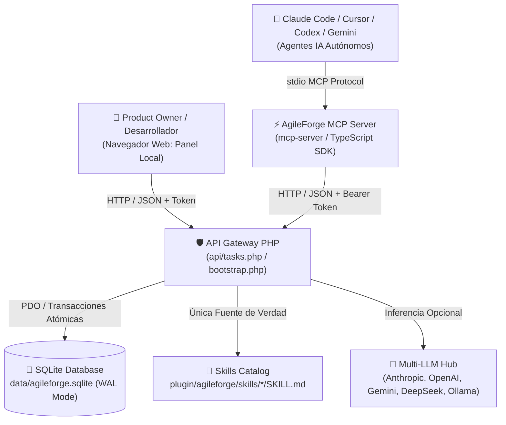
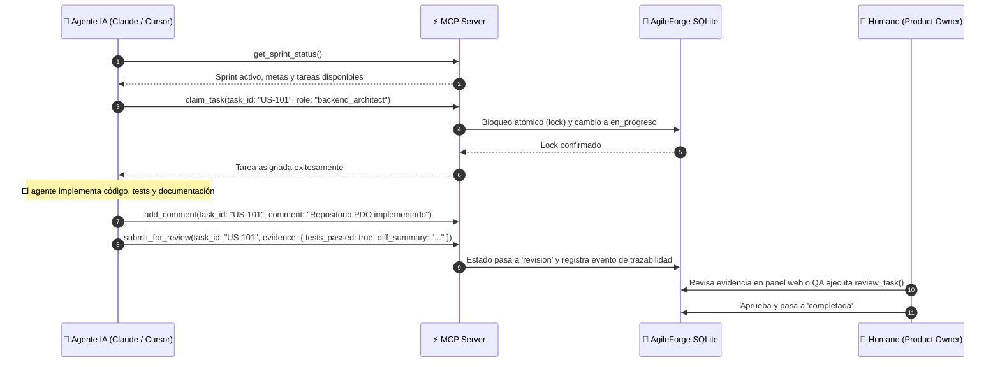

# 🚀 AgileForge v2 — Entorno de Trabajo Multi-Agente & Plugin MCP

> **De un tablero de prompts estático a un ecosistema de ingeniería multi-agente autónomo.**  
> AgileForge v2 permite que agentes de Inteligencia Artificial (**Claude Code, Cursor, Codex CLI, Gemini CLI**) y desarrolladores humanos colaboren sobre un mismo tablero Scrum en tiempo real, con persistencia transaccional SQLite, herramientas MCP, gobernanza humana y auditorías honestas.

> 📖 **¿Recién empezando?** Revisa el **[Manual para Novatos / Beginner's Guide](MANUAL_NOVATOS.md)** con instrucciones paso a paso, modo día/noche, soporte bilingüe (ES/EN) y consejos prácticos.

---

## 🏛️ Arquitectura General



### Componentes Clave:
1. **Base de Datos SQLite Transaccional (`data/agileforge.sqlite`):**
   - Modo WAL (*Write-Ahead Logging*) con `busy_timeout = 5000ms` y transacciones inmediatas para evitar condiciones de carrera entre agentes concurrentes.
   - Tablas: `projects`, `sprints`, `roles`, `skills`, `role_skills`, `tasks`, `task_events`, `comments`, `meetings`, `meeting_turns`, `decisions`, `chat_messages`, `ai_token_usage`, `settings`.
2. **Blindaje de Seguridad:**
   - Token criptográfico único en `.env` fuera del alcance de terceros (`Require all denied` en Apache).
   - Verificación estricta de `Host` y `Origin` (`localhost`).
   - Content-Type forzado a `application/json`.
   - Protección contra Path Traversal con lista blanca de directorios locales.
   - Sanitización contra XSS (`escapeHtml`) en todas las vistas.
3. **Servidor MCP de Alta Disponibilidad (`mcp-server/`):**
   - Construido en TypeScript con el SDK oficial `@modelcontextprotocol/sdk` (transporte `stdio`).
   - 14 herramientas validadas con `zod`: locks de tareas, entregas con evidencia, actas de reunión y ADRs.
   - Recursos URI nativos: `agileforge://sprint/current`, `agileforge://task/{id}`, `agileforge://roles`.
4. **Plugin Oficial para Claude Code (`plugin/agileforge/`):**
   - 7 subagentes con roles reales: Project Manager, Creative Director, Chief Architect, Frontend Master, Backend Master, QA Sentinel, Legal Counsel.
   - Catálogo de 31 skills documentadas en archivos reales `SKILL.md`.
   - 5 comandos de barra: `/sprint`, `/tomar <US-id>`, `/reunion <tipo> <tema>`, `/dod <US-id>`, `/daily`.
   - Hook `SessionStart` con resumen del sprint al abrir la sesión.
5. **Frontend Web Modular (ES Modules Nativos):**
   - Módulos desacoplados: `app.js`, `state.js`, `ui.js`, `kanban.js`, `chat.js`, `meetings.js`, `skills.js`, `ux-lab.js`, `projects.js`, `legal.js`.
   - Tema *Obsidian Dark* de alta densidad, paleta accesible y atajo global `Ctrl+K`.

---

## ⚡ Instalación y Puesta en Marcha (3 Pasos)

### 1. Clonar el repositorio
```bash
git clone https://github.com/<tu-usuario>/<tu-repo>.git
cd <tu-repo>
```

### 2. Configurar entorno e inicializar base de datos
```bash
# Inicializar la base de datos SQLite y autogenerar el archivo .env con token seguro:
php bin/migrate.php
```
> Si prefieres configurar manualmente tu token y proveedores, copia `.env.example` a `.env` antes de ejecutar la migración.

### 3. Compilar el servidor MCP
```bash
cd mcp-server
npm install
npm run build
cd ..
```

### 4. Servir la aplicación
- **Con XAMPP / Apache:** Ubica la carpeta en `htdocs/` y accede a `http://localhost/Open-to-code/`.
- **Con servidor interno de PHP:**
```bash
php -S localhost:8000
```

---

## 👨‍💻 Guía de Uso para Humanos (Product Owner / Líder Técnico)

### 1. Acceso al Panel Web
Abre tu navegador en:
```
http://localhost/Open-to-code/
```

### 2. Gestión Multi-Proyecto y Workspaces
- **Selector en la cabecera:** Alterna en 1 clic entre proyectos aislados (cada uno con su propio sprint y backlog en SQLite).
- **Nuevo Proyecto (`+`):** Crea un nuevo espacio de trabajo definiendo nombre y ruta en disco.
- **Importar Workspace (`📥`):** Permite ingresar la ruta de una carpeta local o repositorio Git. AgileForge escanea los últimos commits del `git log` y genera automáticamente un backlog inicial con historias asignadas a los agentes especialistas.

### 3. Tablero Kanban Scrum y Filtros Combinables
- **4 Columnas:** *Backlog*, *En Progreso*, *En Revisión (DoD)* y *Completadas*.
- **Filtros combinables en tiempo real:**
  - Búsqueda por texto (filtra por ID, título, historia o skills requeridas).
  - Selector de Agente / Rol asignado.
  - Selector de Prioridad (Crítica, Alta, Media, Baja).
  - Selector de Skill requerida.
- **Regla de Gobernanza:** Ningún agente puede pasar una historia a *Completada* por sí solo; el paso a *Completada* requiere validación humana o dictamen del rol QA.

### 4. Laboratorio UX/UI Honesto (Pestaña "Laboratorio UX/UI")
- **Inspección en Vivo del DOM:** Analiza dinámicamente imágenes sin `alt`, inputs sin `<label>`, botones sin texto accesible y contraste.
- **Analizador de Viewport:** Mide el ancho y alto real de la ventana (`window.innerWidth` x `window.innerHeight`), detecta el breakpoint activo de Tailwind y verifica ergonomía táctil.
- **Checklist Interactivo de las 10 Heurísticas de Nielsen:** Permite evaluar cada heurística (Cumple / Pendiente) y persistir el resultado real en SQLite vía el botón *"Guardar Evaluación"*.
- **Cero Certificaciones Falsas:** Se eliminaron etiquetas inventadas; toda métrica indica si es medición del DOM o estimación heurística humana.

### 5. Salas de Reunión Multi-Agente & Consejos Ágiles
- **Mesa Redonda:** Convoca a 2 o más agentes para *Brainstorming de Innovación* o *Consejos de Arquitectura (ADR)*.
- **Debate Colaborativo:** Los agentes deliberan por turnos acumulando contexto y emiten un acta formal con resumen, resolución y acuerdos.
- **Gobernanza de Acuerdos:** Los *action items* solo se convierten en historias de backlog cuando el usuario pulsa *"Convertir acuerdos en historias de backlog"*.

### 6. Auditoría de Inversión y Consumo de Tokens
- Haz clic en **"Inversión IA"** en el banner del Sprint para abrir el desglose contable:
  - Total de llamadas API y tokens (entrada y salida).
  - Costo estimado en USD basado en las tarifas de `config/models.json`.
  - Desglose por cada rol de agente.

---

## 🤖 Guía de Uso para Agentes IA (Claude Code, Cursor, Codex, Gemini)

### 1. Instalación en Claude Code (Modo Plugin)

1. En la raíz de tu proyecto, agrega el plugin al marketplace local de Claude:
```bash
/plugin marketplace add ./
```
2. Instala el plugin `agileforge`:
```bash
/plugin install agileforge
```
3. Verifica los comandos disponibles:
```bash
/sprint             # Muestra el estado del sprint, puntos y bloqueos
/tomar US-101       # Toma la historia, asigna lock y cambia a en_progreso
/dod US-101         # Consulta los criterios de aceptación DoD
/reunion adr "Persistencia en SQLite" # Convoca un debate entre agentes
/daily              # Genera el resumen diario del escuadrón
```

### 2. Configuración en Otras IAs (Cursor, Codex CLI, Gemini CLI)

AgileForge expone el servidor MCP estándar vía `stdio`. Configura tu cliente favorito usando las plantillas incluidas en la carpeta `adapters/`:

#### En Cursor (`.cursor/mcp.json`):
```json
{
  "mcpServers": {
    "agileforge": {
      "command": "node",
      "args": ["d:/xampp/htdocs/Open-to-code/mcp-server/dist/index.js"],
      "env": {
        "AGILEFORGE_API_TOKEN": "tu_token_de_punto_env"
      }
    }
  }
}
```

#### En Gemini CLI o Codex CLI:
Consulta los archivos [`adapters/gemini.json`](file:///d:/xampp/htdocs/Open-to-code/adapters/gemini.json) y [`adapters/codex.json`](file:///d:/xampp/htdocs/Open-to-code/adapters/codex.json).

---

## 🔄 Flujo de Trabajo Autónomo de los Agentes

Cualquier IA conectada debe seguir el siguiente protocolo de ingeniería:



---

## 🛠️ Herramientas MCP Disponibles

| Herramienta | Descripción | Parámetros Clave |
| :--- | :--- | :--- |
| `get_sprint_status` | Devuelve sprint activo, días restantes, velocidad, puntos por columna y bloqueos. | Ninguno |
| `list_tasks` | Lista historias con filtros combinados. | `status`, `role`, `priority`, `project_id` |
| `get_task` | Detalle completo de historia: DoD, skills, prompts, comentarios y eventos. | `task_id` |
| `claim_task` | Toma una historia con lock atómico para evitar que dos agentes se pisen. | `task_id`, `role` |
| `update_task_status` | Cambia el estado de una historia exigiendo nota de avance. | `task_id`, `status`, `note` |
| `add_comment` | Registra reporte técnico de avance o dudas. | `task_id`, `role`, `comment` |
| `submit_for_review` | Mueve historia a revisión con evidencia de tests y resumen de diffs. | `task_id`, `role`, `evidence` |
| `review_task` | Aprueba o solicita cambios sobre una historia en revisión (solo QA/PO). | `task_id`, `role`, `decision`, `notes` |
| `create_task` | Permite descomponer historias para el Backlog (aprobación humana requerida). | `title`, `assigned_to`, `story_points`, `user_story`, `dod` |
| `start_meeting` | Convoca una mesa de debate (Brainstorming o ADR). | `meeting_type`, `topic`, `participants` |
| `add_meeting_turn` | Registra una intervención argumentada de un rol en el debate. | `meeting_id`, `role_id`, `statement` |
| `close_meeting` | Concluye la reunión emitiendo acta, resolución y *action items*. | `meeting_id`, `summary`, `resolution`, `action_items` |
| `record_decision` | Registra un Architectural Decision Record (ADR) formal en SQLite. | `title`, `context`, `decision`, `consequences` |
| `get_role_brief` | Devuelve el system prompt del rol, sus skills activas y la normativa legal. | `role_id` |

---

## ⚙️ Configuración del Entorno (`.env`)

Crea o edita el archivo `.env` en la raíz del proyecto:

```ini
# Token criptográfico de acceso local a la API (generado automáticamente)
AGILEFORGE_API_TOKEN=tu_token_sha256_aqui
AGILEFORGE_DB_PATH=data/agileforge.sqlite
AGILEFORGE_ENV=local

# Claves de API para Modo Directo (Opcional - solo si se usa Modo API en vez de Modo Plugin)
ANTHROPIC_API_KEY=
OPENAI_API_KEY=
GEMINI_API_KEY=
DEEPSEEK_API_KEY=
```

> **Nota:** En **Modo Plugin** (por defecto), las llamadas a los modelos corren a través del cliente host (Claude Code, Cursor, etc.), por lo que no es obligatorio configurar claves de API en `.env`.

---

## 🦙 IA Local (Ollama)

AgileForge detecta si hay una IA local en tu PC y te deja activarla o desactivarla con un clic.

- **Botón 🦙 "IA local"** en la barra superior: muestra *No detectada*, *Apagada* o el modelo activo. Clic para activar/desactivar (o para buscar de nuevo si no la encuentra).
- **Motor IA → "IA local en esta PC"**: elegir modelo, volver a detectar y hacer una prueba rápida (muestra tokens/s).
- **Cuando está activada**, el chat y las reuniones las responde el modelo local vía `http://127.0.0.1:11434` (o `OLLAMA_HOST` en `.env` si apunta a esta máquina). No se envía nada a la nube y el costo registrado es 0.
- Se detecta también LM Studio (`127.0.0.1:1234`), solo como información.
- Acciones de la API (`api/tasks.php`): `detect_local_ai`, `toggle_local_ai` (`enabled`, `model`), `update_local_ai` (`model`, `num_ctx`), `test_local_ai`.

Motores locales soportados:

- **Ollama** (`127.0.0.1:11434`, o `OLLAMA_HOST`).
- **Colibri** (`127.0.0.1:8000`, o `COLIBRI_HOST`): motor para modelos MoE grandes que guarda los expertos más usados en GPU/RAM y lee el resto del NVMe. API compatible con OpenAI.

Modelos instalados en esta PC (RTX 3050 8 GB + 64 GB RAM):

| Motor | Modelo | Velocidad medida | Memoria | Uso |
|---|---|---|---|---|
| Ollama | `gemma4:e4b` | ~80 tokens/s | ~6 GB de VRAM | Rápido, para el día a día |
| Ollama | `gemma4:26b` | ~21 tokens/s | ~19 GB de RAM | Más calidad, ocupa mucha RAM |
| Colibri | `qwen3.6-colibri` (Qwen3.6-35B-A3B) | ~10 tokens/s | ≤12 GB RAM, 2,5 GB VRAM | La mejor calidad sin quitarle memoria a tu trabajo |

Modelos de Ollama en `D:\ollama`; Colibri en `D:\colibri` y su modelo en `D:\colibri-models`.

### Colibri: instalar, iniciar y detener

- `bin\colibri-instalar.cmd`: descarga Colibri (versión fija revisada), instala el motor CUDA y el modelo Qwen3.6-35B-A3B (23 GB) y lo deja corriendo en segundo plano.
- `bin\colibri-iniciar.cmd` / `bin\colibri-detener.cmd`: iniciarlo otro día o liberar la memoria.
- Límites de memoria en `%LOCALAPPDATA%\colibri\setup.json` (`--ram 12 --vram 2.5 --ctx 16384`). Para más velocidad cuando no estés usando otras apps pesadas, sube `--ram` (p. ej. 20) y `--vram` (p. ej. 5) y reinícialo.

---


### 🐦 Acceso directo "Colibri IA" y encendido automático

- **Escritorio → "Colibri IA"**: enciende Colibri, lo abre en su propia ventana y, al cerrarla, lo apaga.
  Si AgileForge lo está usando (IA local activada con Colibri), no lo apaga.
  Se crea con `bin\colibri-crear-acceso-directo.cmd`.
- **Motor IA → "Permitir que AgileForge encienda y apague Colibri"**: con ese permiso y la IA local activada
  con Colibri, AgileForge lo enciende cuando lo necesita y lo apaga al desactivar la IA local
  (salvo que la ventana "Colibri IA" esté abierta). Sin el permiso, solo usa Colibri si tú lo abriste.
- Los scripts de control están en `%LOCALAPPDATA%\colibri\agileforge\` (`colibri-control.ps1 start|stop|status`)
  y la coordinación usa `%LOCALAPPDATA%\colibri\run\agileforge.lease` y `desktop.lease`.
- Ruta configurable en `config/local-ai.json` (`colibri_home`).

## 🧪 Verificación y Pruebas del Sistema

Para ejecutar la suite de verificación completa:

```bash
# 1. Verificar base de datos y migración SQLite
php bin/migrate.php

# 2. Compilar y verificar servidor MCP
cd mcp-server && npm run build && cd ..

# 3. Comprobar sintaxis de módulos ES
node -c assets/js/app.js

# 4. Verificar API y endpoints locales
php -l index.php
```

---

## 📜 Licencia & Estándares
- **Metodología:** Agile Scrum + PMBOK 7ma Edición.
- **Diseño & Heurísticas:** Nielsen Norman Group (10 Usability Heuristics).
- **Seguridad:** OWASP Top 10 API Security Compliance.
- **Desarrollado para:** Ecosistema de Agentes de IA y Equipos de Desarrollo Ágil.

