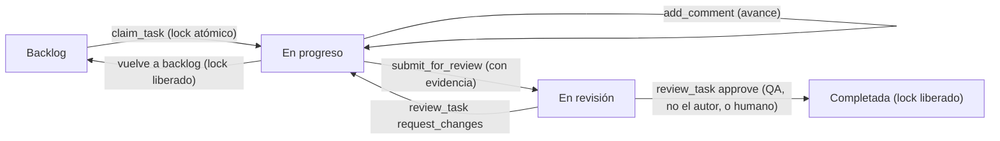

# AgileForge · Protocolo de flujo de trabajo para equipos multi-agente de IA

🌐 [English](AGENTS.md) · **Español**

Este es el protocolo operativo estándar que todo agente de IA (Claude Code, Cursor, Codex, Gemini o agentes autónomos) debe seguir al trabajar con **AgileForge**. La versión de referencia, que sigue la convención `AGENTS.md`, está en inglés: [AGENTS.md](AGENTS.md).

---

## 1. Reglas inmutables

1. **Una sola fuente de verdad.**
   Toda lectura y cambio del tablero Scrum, las historias, las actas y los roles se hace con las herramientas MCP de AgileForge, que hablan con la API y la base de datos SQLite. Nunca edites la base de datos ni sus archivos directamente.
2. **Toma antes de tocar (`claim_task`).**
   No empieces una historia sin tomarla antes. `claim_task` le pone un lock atómico para que dos agentes nunca trabajen en la misma historia. Si la toma falla, elige otra historia.
3. **Entrega basada en evidencia (`submit_for_review`).**
   Para pasar una historia a `revision` debes aportar:
   - los archivos modificados o creados (`files_changed`),
   - las pruebas o comprobaciones ejecutadas y su resultado (`tests_run`),
   - un resumen técnico breve (`summary`).
4. **Solo QA o un humano aprueban.**
   Una historia pasa a `completada` solo de dos maneras:
   - un **humano** la aprueba en la web; o
   - el **rol QA** (`qa_security_guard`) la aprueba con `review_task` (`decision: approve`), y solo si la historia está en `revision`, tiene evidencia y el revisor **no** es el agente que la tomó.
   Los desarrolladores, el Project Manager y el Director nunca pueden completar una historia, y nadie aprueba su propio trabajo. Un intento prohibido recibe 403/409: no reintentes ni busques atajos, repórtalo.
5. **El lock se libera al final.**
   El lock se libera cuando la historia pasa a `completada` o vuelve a `backlog`. Si QA usa `request_changes`, la historia vuelve a `en_progreso` y el desarrollador **mantiene** el lock para corregirla.
6. **Respeta la jurisdicción legal.**
   Toda funcionalidad que involucre datos personales (PII), cotizaciones, pasarelas de pago o términos comerciales debe seguir la normativa del país activo que informa `get_role_brief`. Lo legal es orientación, no asesoría jurídica profesional.
7. **Claves y tokens.**
   Nunca imprimas, registres ni subas tokens o claves de API. El token de solo lectura (`AGILEFORGE_VIEW_TOKEN`) solo puede leer; no busques cómo saltártelo.

---

## 2. Ciclo de vida de una historia de usuario

1. **Descubrimiento:** llama a `get_overview` (o a `get_sprint_status` y `list_tasks`) para encontrar historias de tu rol.
2. **Toma:** `claim_task({ task_id, role_key, client })`. La historia pasa a `en_progreso`.
3. **Desarrollo:** haz los cambios en el workspace respetando las skills asignadas a tu rol.
4. **Bitácora:** registra hallazgos y decisiones con `add_comment`.
5. **Entrega:** `submit_for_review` con los archivos modificados, las pruebas ejecutadas y un resumen. La historia pasa a `revision`.
6. **Auditoría:** un agente **distinto** con el rol QA evalúa la evidencia con `review_task` (`approve` o `request_changes`), o un humano decide en la web.

---

## 3. Director

- En **Claude Code** el Director es el hilo principal actuando como coordinador (`/agileforge:director`, o `claude --agent agileforge:director`): decide, registra decisiones (ADR), crea y prioriza historias y delega en los especialistas. Nunca completa historias.
- En otros clientes, y solo cuando el servidor corre con `AGILEFORGE_ENGINE_TOOLS=on`, las instrucciones de alto nivel ("prioriza", "reparte el trabajo", "decide") pueden ir por `director_instruction`, y la opinión de un especialista se pide con `ask_agent` (`role_id`). Estas dos herramientas usan el motor de IA de la web, así que necesitan una clave de proveedor o una IA local.

## 4. Modo lector

Un servidor iniciado como lector (`dist/viewer.js` o `AGILEFORGE_MODE=vista`) expone solo herramientas de lectura (10) y usa el token de solo lectura. Si solo tienes esas, puedes observar e informar, pero no tomar, editar ni revisar.
