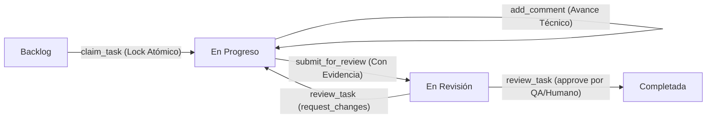

# AgileForge · Protocolo de Flujo de Trabajo para Equipos Multi-Agente IA

Este documento define el protocolo operativo estándar que todo agente de IA (Claude Code, Cursor, Codex, Gemini o agentes autónomos) debe seguir al interactuar con el ecosistema **AgileForge**.

---

## 1. Reglas Inmutables de Operación

1. **Una Sola Fuente de Verdad**:
   Toda lectura y modificación del tablero Scrum, historias, actas y roles se realiza a través de las herramientas MCP de AgileForge conectadas a la API y la base de datos relacional SQLite (`data/agileforge.sqlite`). Prohibido escribir o modificar datos en plano sin transacciones.
2. **Lock Atómico de Tareas (`claim_task`)**:
   Ningún agente puede comenzar a trabajar en una historia sin haberla tomado primero con `claim_task`. El sistema bloquea la historia con un candado atómico impidiendo que dos agentes modifiquen la misma funcionalidad a la vez.
3. **Entrega Basada en Evidencia (`submit_for_review`)**:
   Para mover una tarea a `revision`, el agente debe proporcionar obligatoriamente:
   - Lista de archivos modificados o creados (`files_changed`).
   - Resultados de pruebas ejecutadas (`tests_run`).
   - Resumen técnico de la implementación (`summary`).
4. **Aprobación Humana / QA Obligatoria**:
   Ningún agente desarrollador puede marcar una historia como `completada` por sí mismo. Solo el rol **QA Auditor** (`review_task`) o el **Product Owner Humano** desde el panel web pueden certificar la Definition of Done y autorizar el paso a completada.
5. **Respeto a la Jurisdicción Legal**:
   Toda funcionalidad que involucre datos personales (PII), cotizaciones, pasarelas de pago o términos comerciales debe apegarse a la normativa del país activo reportada por `get_role_brief`.

---

## 2. Ciclo de Vida de una Historia de Usuario

1. **Descubrimiento**: El agente consulta `get_sprint_status` y `list_tasks` para identificar historias asignadas a su rol en el backlog.
2. **Toma y Bloqueo**: Ejecuta `claim_task({ task_id, role_key, client })`. La historia pasa a `en_progreso`.
3. **Desarrollo**: El agente realiza las modificaciones en el workspace local respetando las skills asignadas.
4. **Bitácora**: Si surgen hallazgos técnicos o decisiones intermedias, registra notas con `add_comment`.
5. **Entrega**: Al concluir, ejecuta `submit_for_review` adjuntando los tests y archivos modificados.
6. **Auditoría de DoD**: El agente de QA (`qa_security_guard`) evalúa la evidencia con `review_task`.

