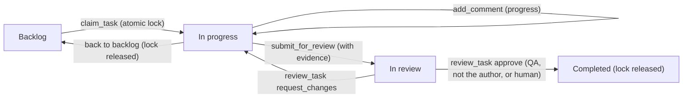

# AgileForge · Workflow Protocol for Multi-Agent AI Teams

🌐 **English** · [Español](AGENTS.es.md)

This is the standard operating protocol that every AI agent (Claude Code, Cursor, Codex, Gemini or autonomous agents) must follow when working with **AgileForge**. It follows the `AGENTS.md` convention, so it is kept in English; a Spanish copy is in [AGENTS.es.md](AGENTS.es.md).

---

## 1. Immutable rules

1. **Single source of truth.**
   Every read and change of the Scrum board, stories, minutes and roles goes through the AgileForge MCP tools, which talk to the API and the SQLite database. Never edit the database or its files directly.
2. **Claim before you touch (`claim_task`).**
   Do not start a story without claiming it first. `claim_task` puts an atomic lock on it so two agents never work on the same story. If the claim fails, pick another story.
3. **Evidence-based delivery (`submit_for_review`).**
   To move a story to `revision` you must provide:
   - the files changed or created (`files_changed`),
   - the tests or checks you ran and their result (`tests_run`),
   - a short technical summary (`summary`).
4. **Only QA or a human approves.**
   A story becomes `completada` in only two ways:
   - a **human** approves it in the web app; or
   - the **QA role** (`qa_security_guard`) approves it with `review_task` (`decision: approve`), and only if the story is in `revision`, has evidence, and the reviewer is **not** the agent that claimed it.
   Developers, the Project Manager and the Director can never complete a story, and nobody approves their own work. A forbidden attempt is answered with 403/409: do not retry or look for a workaround, report it.
5. **The lock is released at the end.**
   The lock is freed when the story becomes `completada` or goes back to `backlog`. If QA uses `request_changes`, the story returns to `en_progreso` and the developer **keeps** the lock to fix it.
6. **Respect the legal jurisdiction.**
   Any feature involving personal data (PII), quotes, payment gateways or commercial terms must follow the rules of the active country reported by `get_role_brief`. Legal output is guidance, not professional legal advice.
7. **Keys and tokens.**
   Never print, log or commit tokens or API keys. The read-only token (`AGILEFORGE_VIEW_TOKEN`) can only read; do not look for ways around it.

---

## 2. Life cycle of a user story

1. **Discover:** call `get_overview` (or `get_sprint_status` and `list_tasks`) to find stories for your role.
2. **Claim:** `claim_task({ task_id, role_key, client })`. The story moves to `en_progreso`.
3. **Work:** make the changes in the workspace, following the skills assigned to your role.
4. **Log:** record findings and decisions with `add_comment`.
5. **Deliver:** `submit_for_review` with the files changed, the tests run and a summary. The story moves to `revision`.
6. **Audit:** a **different** agent with the QA role evaluates the evidence with `review_task` (`approve` or `request_changes`), or a human decides in the web app.

---

## 3. Director

- In **Claude Code** the Director is the main thread acting as a coordinator (`/agileforge:director`, or `claude --agent agileforge:director`): it decides, records decisions (ADR), creates and prioritizes stories and delegates to specialists. It never completes stories.
- In other clients, and only when the server runs with `AGILEFORGE_ENGINE_TOOLS=on`, high-level instructions ("prioritize", "split the work", "decide") can go through `director_instruction`, and an opinion from one specialist can be requested with `ask_agent` (`role_id`). These two tools use the web app's AI engine, so they need a provider key or a local AI.

## 4. Read-only mode

A server started as viewer (`dist/viewer.js` or `AGILEFORGE_MODE=vista`) exposes only read tools (10) and uses the read-only token. If you only have those, you may observe and report, but not claim, edit or review.
