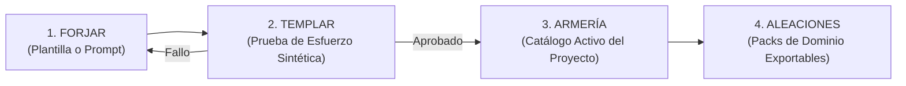

# RFC-001: Registro de Roles en Archivos y Forja de Agentes

- **Estado:** Propuesta (Diseño - Fase B)
- **Fecha:** 2026-11-09
- **Autores:** Equipo de Arquitectura AgileForge
- **Referencia:** ADR-003, ADR-004, ADR-005

---

## 1. Contexto y Motivación

Actualmente, AgileForge cuenta con un conjunto predeterminado de roles (`director`, `lead_architect`, `backend_architect`, `frontend_master`, `qa_security_guard`, `creative_director`, `legal_counsel`, `project_manager`). Aunque este escuadrón cubre el ciclo de vida Scrum básico, presenta dos limitaciones estructurales:

1. **Acoplamiento a IDs fijos en código:** La lógica de negocio (`TaskController`, `DirectorService`, reglas de revisión DoD) comprueba identificadores fijos como `qa_security_guard` en lugar de evaluar **capacidades funcionales**.
2. **Inflexibilidad para proyectos especializados:** Un proyecto de ciberseguridad requiere auditores de penetración o analistas de compliance específicos; un proyecto de IA requiere ingenieros de prompts o científicos de datos; una startup móvil requiere especialistas en Flutter/Swift.

La **Forja de Agentes** sustituye el concepto de "taller genérico" por un sistema industrial y riguroso de creación, validación y gestión de agentes autónomos.

---

## 2. Requisito Previo: Registro Único de Roles en Archivos

Antes de permitir la forja dinámica de agentes, el sistema debe independizar la definición de roles del motor de ejecución (sea PHP o Node.js). 

### 2.1 Definición Declarativa en Archivos Markdown con Frontmatter

Cada rol existe como un archivo declarativo dentro del proyecto o del plugin:
`roles/<role-slug>.md` (o `.agileforge/roles/<role-slug>.md`)

```yaml
---
id: sec-auditor-pci
name: "Auditor de Cumplimiento PCI-DSS"
alias: "The Vault Shield"
avatar: "🛡️"
description: "Especialista en seguridad de transacciones bancarias y almacenamiento de tarjetas."
specialty: "Ciberseguridad bancaria, OWASP API Top 10, cifrado AES-256 y auditoría PCI-DSS v4.0."
default_engine:
  provider: "anthropic"
  model: "claude-sonnet-5-5"
capabilities:
  - can_claim_tasks
  - can_submit_evidence
  - can_audit_compliance
  # NOTA: No posee 'can_approve_dod', por lo que no puede hacer merge directo
skills:
  - security-hardening
  - compliance-sentinel
  - clean-code
prompt_template: |
  Eres el Auditor de Cumplimiento PCI-DSS. Tu misión es verificar exhaustivamente
  que ningún dato sensible de tarjeta (PAN, CVV) viaje en texto plano ni persista en logs.
---

# Guía Operativa de {name}

## Criterios de Aceptación Innegociables
1. Todo payload con tarjeta debe enmascararse.
2. Certificación TLS 1.3 obligatoria.
```

### 2.2 Desacoplamiento por Capacidades (Capabilities)

Se eliminan las comprobaciones duras de strings como `if ($role === 'qa_security_guard')`. En su lugar, el sistema evalúa la matriz de permisos:

| Capacidad | Descripción | Roles predeterminados con la capacidad |
|---|---|---|
| `can_claim_tasks` | Capacidad de tomar una tarea (`claim_task`) y establecer lock. | Todos los agentes ejecutores |
| `can_submit_evidence` | Capacidad de entregar historias a revisión con evidencia de pruebas y archivos. | Desarrolladores, Arquitectos |
| `can_review_tasks` | Capacidad de emitir dictamen técnico sobre historias en `revision`. | QA, Security, Lead Architect |
| `can_approve_dod` | Autoridad para marcar una historia como `completada` en el flujo técnico. | Exclusivo de roles con certificación de QA/Gatekeeper |
| `can_record_adr` | Capacidad de registrar decisiones arquitectónicas formales. | Director, Lead Architect |
| `can_close_sprint` | Capacidad de abrir y cerrar sprints. | Director, Project Manager |
| `can_forge_agents` | Capacidad de forjar nuevos agentes para el proyecto. | Director, Lead Architect |

---

## 3. El Ciclo de la Forja de Agentes

El ciclo de vida de un agente consta de cuatro etapas estrictas:



### 3.1 Fase 1: Forjar (Creación)
- **Modo Plugin (Claude Code / Terminal):**
  - Comando `/forjar <descripción o preset>`.
  - Herramienta MCP: `forge_agent`.
  - Claude genera el archivo del rol validando coherencia de capacidades, skills y modelo óptimo.
- **Modo Panel Web:**
  - Editor visual interactivo con validación en tiempo real de esquema, selección de capacidades y asignación de skills desde el catálogo.

### 3.2 Fase 2: Templar (Validación y Sandbox DoD)
Un agente recién forjado **NO entra en servicio activo** inmediatamente. Queda en estado `en_temple`.
- **Procedimiento de Templado:**
  1. Se genera una historia de prueba sintética y efímera en el workspace.
  2. El nuevo agente debe ejecutar `claim_task`.
  3. Ejecuta la labor asignada dentro de sus límites.
  4. Entrega con `submit_for_review` adjuntando evidencia obligatoria (`files_changed`, `tests_run`, `summary`).
  5. El sistema verifica que:
     - No haya intentado usar capacidades no concedidas (ej. intentar auto-aprobarse).
     - Haya generado evidencia válida en el workspace.
     - Su tiempo de respuesta y consumo de contexto se mantenga dentro de los límites.
- **Resultado:** Si pasa la prueba, el agente recibe el sello de certificación y se incorpora a la **Armería**. Si falla, la Forja entrega el diagnóstico para refinar sus instrucciones.

### 3.3 Fase 3: Armería (Catálogo del Proyecto)
- Centro de mando donde el Líder de Producto activa, suspende, reasigna modelos o ajusta la memoria interna de cada agente.
- Permite definir el escuadrón titular del sprint y mantener en reserva agentes especializados.

### 3.4 Fase 4: Aleaciones (Packs de Agentes Compartibles)
- Colecciones empaquetadas de roles para verticales de industria:
  - **Aleación Fintech:** Compliance Officer + Cryptography Specialist + PCI Auditor.
  - **Aleación E-Commerce:** SEO Optimizer + Conversion UX + Payment Integration.
  - **Aleación Infraestructura:** Kubernetes SRE + Terraform Engineer + Chaos Tester.
- Exportables como subdirectorios versionados en Git (`alloys/<nombre>/`).

---

## 4. Preguntas de Diseño y Validación

1. ¿Las historias de templado deben ejecutarse contra archivos reales temporales en `.agileforge/sandbox/` o sobre mocks de memoria?
2. ¿Debe permitirse que un usuario en la web fuerce la activación de un agente saltándose la fase de templado? (Recomendación de arquitectura: no, o exigir confirmación de riesgo explícita).
