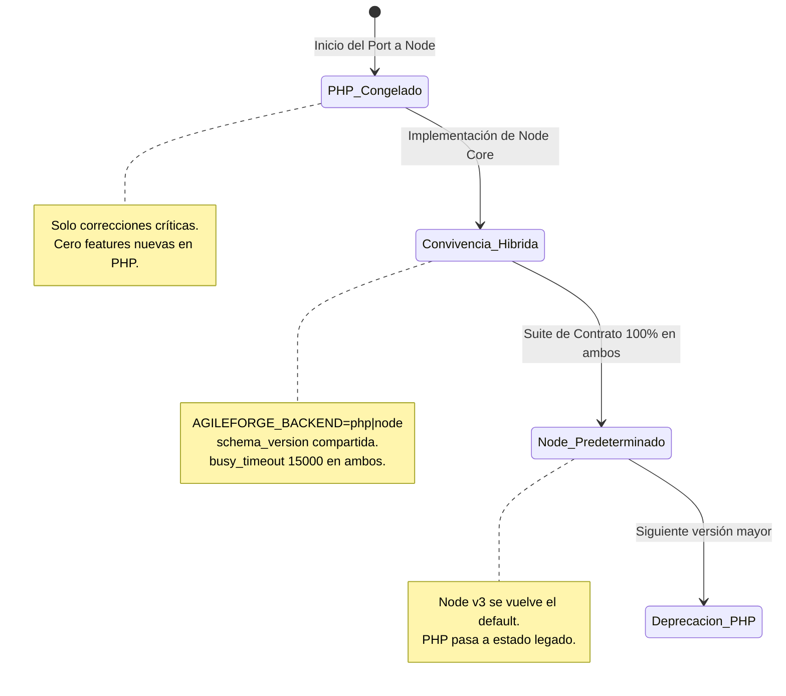

# RFC-002: Repositorio Autoinstalable y Migración del Núcleo a Node.js

- **Estado:** Aprobado por David (2026-11-10)
- **Fecha:** 2026-11-09
- **Autores:** David & Equipo de Arquitectura AgileForge
- **Referencia:** ADR-001, ADR-002, ADR-004, RFC-001

---

## 1. Visión y Objetivo

**Meta principal:** Permitir que cualquier desarrollador o asistente de inteligencia artificial (Claude Code, Cursor, Codex, Gemini Code Assist) clone el repositorio y establezca un entorno 100% operativo ejecutando un único comando o consultando una sola guía canónica, con cero ambigüedad y sin improvisación.

Adicionalmente, se define la **unificación total del backend en Node.js**, erradicando la dependencia de PHP/Apache/XAMPP para consolidar una biblioteca de núcleo compartida con el servidor MCP y el panel web.

---

## 2. Experiencia de Autoinstalación Universal

### 2.1 Enrutamiento de Guías: Una Única Fuente de Verdad

```
                    ┌────────────────────────┐
                    │      INSTALL.md        │
                    │ (Única fuente canónica:│
                    │  paso a paso, comandos │
                    │   exactos e idempotente)│
                    └───────────▲────────────┘
                                │
        ┌───────────────────────┼────────────────────────┐
        │                       │                        │
┌───────┴────────┐      ┌───────┴────────┐      ┌────────┴────────┐
│   CLAUDE.md    │      │   AGENTS.md    │      │    README.md    │
│  (Claude Code) │      │ (Codex/Cursor/ │      │ (Personas y     │
│                │      │    Gemini)     │      │  bloque rápido) │
└────────────────┘      └────────────────┘      └─────────────────┘
```

- **`INSTALL.md`:** Especificación paso a paso de prerrequisitos, variables de entorno, arranque de servicios y verificación de salud.
- **`CLAUDE.md` y `AGENTS.md`:** Instrucción estricta para asistentes de código:
  > *"Para instalar o configurar este proyecto, NO improvises comandos ni uses herramientas externas no especificadas. Lee y ejecuta estrictamente las instrucciones de `INSTALL.md`."*
- **Bloque en `README.md` ("Copia esto a tu IA"):**
  ```markdown
  ### 🤖 Instalación Asistida por IA
  Copia y pega este mensaje en tu asistente (Claude Code, Cursor, Codex o Gemini):
  > "Configura el entorno de desarrollo de AgileForge siguiendo estrictamente la guía `INSTALL.md`. Ejecuta la instalación, corre el diagnóstico con `npm run doctor` y confírmame cuando el servidor y el MCP estén listos para operar."
  ```

### 2.2 Un Solo Comando de Instalación Idempotente

El proceso de preparación se unifica en un comando determinista multiplataforma:

```bash
npm run setup
```
*(Invoca `node bin/setup.mjs`, compatible de forma nativa con Windows PowerShell, macOS y Linux).*

**Operaciones que realiza:**
1. Valida el runtime de Node.js (**mínimo Node.js 22.13.0**; recomienda la última versión LTS).
2. Genera `.env` a partir de `.env.example` si no existe.
3. Genera tokens criptográficamente seguros (`AGILEFORGE_API_TOKEN`, `AGILEFORGE_VIEW_TOKEN`) si están vacíos.
4. Crea la estructura de almacenamiento local (`data/`, `data/backup/`).
5. Instala dependencias en raíz y en `mcp-server/`.
6. Compila TypeScript y construye los bundles de plugin MCP (`npm run build && npm run bundle`).
7. Inicializa el esquema de SQLite asegurando idempotencia.

### 2.3 Un Solo Diagnóstico (`doctor`) en Node.js desde la Fase 2.1

> [!IMPORTANT]
> **Decisión de Arquitectura (David):**
> Existe **un único comando `doctor` escrito en Node.js** (`bin/doctor.mjs` o `npm run doctor`) desde la fase 2.1. No habrá duplicidad de comandos en PHP y Node. El doctor de Node se encarga de auditar el entorno completo, incluyendo la disponibilidad y extensiones de PHP mientras persista la fase de transición híbrida.

```bash
npm run doctor
```

**Verificaciones de salud ejecutadas:**
- [x] **Runtime Node.js:** Verifica `>= 22.13.0` y advierte si no se utiliza la LTS recomendada.
- [x] **PHP (durante convivencia híbrida):** Versión mínima requerida por sintaxis: **PHP 8.0+** (`match`, union types, `mixed`), junto a extensiones `pdo_sqlite`, `mbstring` y `curl`.
- [x] **Integridad SQLite:** Permisos de lectura/escritura en `data/agileforge.sqlite`, pragmas WAL y timeout configurados.
- [x] **Servidor MCP y Bundles:**
  - Presencia del bundle oficial en `plugin/agileforge/server/agileforge-mcp.mjs`.
  - Presencia del bundle de solo lectura en `plugin/agileforge-vista/server/agileforge-vista-mcp.mjs`.
  - Presencia del bundle compilado en `mcp-server/dist/index.js`.
- [x] **Tokens y Seguridad:**
  - Token de API: `Configurado (64 chars; origen: .env)` — **NUNCA imprime el valor del token**.
  - Token de Vista: `Configurado (64 chars; origen: .env)`.
- [x] **Conectividad de Proveedores IA:** Estado de claves configuradas en `.env` (Anthropic, OpenAI, Gemini, DeepSeek) y estado de IA Local (Ollama/Colibri).

---

## 3. Especificación del Núcleo Node.js v3

### 3.1 Requisitos de Runtime y `node:sqlite`

> [!IMPORTANT]
> **Decisión de Arquitectura (David):**
> - **Versión mínima obligatoria:** **Node.js 22.13.0** (versión en la que `node:sqlite` está disponible sin requerir flags de CLI como `--experimental-sqlite`).
> - **Recomendación del Doctor:** Recomienda siempre la versión LTS activa más reciente de Node.js.
> - **Fin de Soporte para Node 18 y 20:** Ambas versiones han alcanzado su fin de vida (EOL) o carecen del módulo nativo estable; quedan terminantemente excluidas.
> - **Sin Driver de Respaldo:** **No se utilizará `better-sqlite3` ni fallbacks nativos.** Esto elimina por completo la necesidad de compilar dependencias C++ con `node-gyp` o Visual Studio Build Tools en Windows.

#### Consideraciones sobre el Estado de `node:sqlite`:
- En la documentación oficial de Node.js 22, `node:sqlite` figura formalmente bajo **Stability: 1.1 "Active development"** (el estatus *Release Candidate* corresponde a Stability 1.2 en revisiones posteriores de la plataforma).
- `node:sqlite` expone la clase síncrona `DatabaseSync`, mapeada directamente sobre la biblioteca C de SQLite 3.
- La capa de acceso a datos de AgileForge (`src/core/storage/sqlite-driver.ts`) aísla la lógica del motor para ofrecer una API uniforme e insensible a variaciones menores entre parches de Node.

---

### 3.2 Arquitectura Multiproceso y Concurrencia en SQLite

> [!WARNING]
> **Aclaración Arquitectónica: Embebido en Varios Procesos (No Proceso Único)**
> Cada sesión de Claude Code (o cliente IDE) ejecuta **su propio proceso Node separado** para el servidor MCP; no comparte el espacio de memoria del panel web.
> "Acceso directo al núcleo" significa que cada proceso MCP importa la biblioteca `@agileforge/core` y lee/escribe directamente en el archivo `data/agileforge.sqlite` en disco, eliminando el salto HTTP intermedio de loopback.
>
> **Consecuencias de Diseño Innegociables:**
> 1. **Reglas de Negocio en el Núcleo:** Las validaciones críticas (solo la web aprueba a `completada` salvo `qa_security_guard`, locks de 30 min, validación de DoD git) deben vivir **en la biblioteca del núcleo** (`src/core`), nunca en middleware o controladores HTTP.
> 2. **Identidad Imposible de Falsificar:** Un proceso MCP que corre por stdio **nunca puede auto-declararse `client=web`** para saltarse el templado o auto-aprobar historias.
> 3. **Preservación del Modo Cliente HTTP:** Se mantiene el cliente HTTP (`AGILEFORGE_API_URL` + Bearer token) para el plugin `agileforge-vista`, tableros remotos y otros IDEs.

Para soportar concurrencia multiproceso sin errores de `SQLITE_BUSY`, se aplica la misma disciplina probada en el backend PHP actual:

```typescript
// src/core/storage/database.ts
import { DatabaseSync } from 'node:sqlite';

export function createDatabaseConnection(dbPath: string): DatabaseSync {
  const db = new DatabaseSync(dbPath);
  
  // 1. Espera activa de 15 segundos ante contención (idéntico al PHP actual)
  db.exec('PRAGMA busy_timeout = 15000;');
  
  // 2. Modo Write-Ahead Logging para permitir lecturas concurrentes sin bloquear escrituras
  db.exec('PRAGMA journal_mode = WAL;');
  
  // 3. Sincronización normal optimizada para WAL
  db.exec('PRAGMA synchronous = NORMAL;');
  
  // 4. Claves foráneas activadas
  db.exec('PRAGMA foreign_keys = ON;');
  
  return db;
}

// 5. Manejo de transacciones sin anidamiento destructivo (savepoints / txDepth)
let txDepth = 0;

export function transaction<T>(db: DatabaseSync, fn: () => T): T {
  if (txDepth === 0) {
    db.exec('BEGIN IMMEDIATE;');
  } else {
    db.exec(`SAVEPOINT sp_${txDepth};`);
  }
  txDepth++;

  try {
    const result = fn();
    txDepth--;
    if (txDepth === 0) {
      db.exec('COMMIT;');
    } else {
      db.exec(`RELEASE SAVEPOINT sp_${txDepth};`);
    }
    return result;
  } catch (originalError) {
    txDepth--;
    try {
      if (txDepth === 0) {
        db.exec('ROLLBACK;');
      } else {
        db.exec(`ROLLBACK TO SAVEPOINT sp_${txDepth};`);
      }
    } catch (rollbackError) {
      // Registrar fallo de rollback sin tapar la excepción original
      console.error('Fallo en ROLLBACK:', rollbackError);
    }
    throw originalError;
  }
}
```

---

### 3.3 Panel Web Seguro en Node.js y Protección DNS Rebinding

1. **Enlace Estricto a `127.0.0.1`:**
   - El servidor HTTP local escucha exclusivamente en `127.0.0.1`, nunca en `0.0.0.0`.
2. **Validación de Cabeceras `Host` y `Origin` (Anti-DNS Rebinding):**
   - El servidor verifica que la cabecera `Host` sea exactamente `127.0.0.1:<puerto>` o `localhost:<puerto>`.
   - Si una petición cross-origin incluye una cabecera `Origin` ajena, se rechaza inmediatamente con `403 Forbidden`.
3. **Inyección Segura de Token al Navegador:**
   - El navegador **no realiza un login interactivo con contraseña**. El token de sesión (`AGILEFORGE_API_TOKEN`) va inyectado de forma segura en el HTML que sirve el servidor Node al arrancar. A partir de ese momento, el cliente JavaScript adjunta `Authorization: Bearer <token>` en todas las llamadas API.

---

## 4. Estimación Detallada del Port a Node.js

| Módulo / Componente | Responsabilidad y Complejidad Técnica | Estimación |
|---|---|---|
| **Capa de Persistencia y Concurrencia** (`Repository`, `DatabaseSync`, WAL, `savepoint`) | Consultas SQLite, `schema_version`, control de transacciones seguras con `BEGIN IMMEDIATE`, `busy_timeout = 15000`. | 3.5 días |
| **Reescritura de Herramientas MCP para Acceso Directo** | Reescritura de `read.ts` y `write.ts` para invocar al core directamente, manteniendo fallback a cliente HTTP vía `AGILEFORGE_API_URL`. | 3 días |
| **DirectorService (Bucle Agéntico)** | Bucle multi-turn de herramientas del Director, llamadas iterativas con Anthropic SDK, parsing de intenciones y acciones sobre el tablero. | 4 días |
| **ChatController con Streaming SSE** | Endpoint de chat con Server-Sent Events nativo, formateo de deltas, manejo de fallbacks de motor sin demoras artificiales. | 2 días |
| **Reuniones Ágiles** (`MeetingController`, `MeetingService`) | Moderación de rondas de turnos entre roles con motor asignado, síntesis de actas, registro de decisiones ADR. | 2.5 días |
| **Configuraciones y Documentos Legales** (`SettingController`) | Generación dinámica de avisos de privacidad y términos por jurisdicción (Perú, UE, USA), lectura/escritura atómica de `.env`. | 2 días |
| **Integración Git** (`ProjectController`) | Extracción de historial, ramas y autores mediante ejecución asíncrona de `git log` con `child_process`. | 2 días |
| **Control de IA Local** (`LocalAiService`) | Detección de procesos Colibri / Ollama en Windows mediante PowerShell y scripts CLI, comprobación de puertos y modelos activos. | 2.5 días |
| **Conversión de `index.php` a Estático con Token** | Transformación de la vista a HTML estático con inyección segura de configuración y token de sesión al servir la página. | 2 días |
| **Endpoints REST y Web Server** | Replicación exacta del contrato JSON de endpoints existentes para tablero, tareas, agentes, métricas y validación Host/Origin. | 3 días |
| **Setup, Doctor y Arranque en Windows** | Implementación de `setup.mjs`, `doctor.mjs` unificado y script/servicio de autoarranque en Windows en sustitución de XAMPP. | 3 días |
| **Pruebas de Paridad y Validación Cruzada** | Ejecución de la suite de pruebas de contrato contra ambos backends (`php` y `node`). | 3.5 días |
| **Total Estimado** | | **33 días hábiles** |

---

## 5. Estrategia de Transición y Coexistencia

> [!IMPORTANT]
> **Decisión de Arquitectura (David):**
> 1. **Interruptor de Entorno:** Durante una versión menor completa, el sistema admite alternar entre backends mediante la variable `AGILEFORGE_BACKEND=php|node` en `.env`.
> 2. **Control Estricto de Migraciones (`schema_version`):**
>    - Para impedir que dos motores modifiquen la base de datos simultáneamente, **solo UN backend ejecuta las migraciones DDL**.
>    - Se implementa la tabla `schema_version`. Si el backend secundario detecta una discrepancia entre su versión esperada y la registrada en la base, **se niega a arrancar y emite un error explícito**.
> 3. **Criterio de Cambio Definitivo:** El backend de Node solo pasará a ser el predeterminado cuando la suite de pruebas de contrato (desarrollada por Claude en `tests/`) **pase con 100% de éxito en ambos backends**.
> 4. **Congelamiento Inmediato de PHP:** A partir de que comience el trabajo de port a Node, el código de `api/` en PHP queda estrictamente congelado: **únicamente se admitirán correcciones críticas de bugs**. Ninguna funcionalidad nueva se programará en PHP.



---

## 6. Selección de Servidor Web: `node:http`

> [!IMPORTANT]
> **Decidido: `node:http` (David, 2026-11-10)**
> Se adopta el módulo nativo `node:http` sin frameworks externos (sin Fastify).
> **Motivo:** Cero dependencias en runtime, uso local y operación de un solo desarrollador. El servidor web ligero servirá los estáticos y los endpoints REST/SSE mediante módulos estándar de Node.js.

---

## 7. Orden Final de Trabajo

El flujo secuencial de desarrollo acordado para garantizar estabilidad continua es el siguiente:

```
┌────────────────────────────────────────────────────────────────────────┐
│ 1. Correcciones Críticas en feat/memoria-nodular                        │
│    (Locks UTC, validación DoD git, memoria por proyecto, budget sprint)│
│    [ESTADO: COMPLETADO ✓] (Commits 06070b1..5e44532)                  │
└───────────────────────────────────┬────────────────────────────────────┘
                                    │
┌───────────────────────────────────▼────────────────────────────────────┐
│ 2. Pruebas de Contrato y CI (Claude en tests/ y .github/ci.yml)        │
│    Blindaje de la API actual antes de cualquier cambio estructural.    │
└───────────────────────────────────┬────────────────────────────────────┘
                                    │
┌───────────────────────────────────▼────────────────────────────────────┐
│ 3. Repo Autoinstalable (INSTALL.md, AGENTS.md, CLAUDE.md, doctor Node) │
│    Un solo comando `npm run doctor` en Node que valida Node y PHP.     │
└───────────────────────────────────┬────────────────────────────────────┘
                                    │
┌───────────────────────────────────▼────────────────────────────────────┐
│ 4. Registro de Roles en Archivos con Capacidades (sobre PHP)           │
│    Desacoplamiento de roles hacia roles/<id>.md en el repo actual.     │
└───────────────────────────────────┬────────────────────────────────────┘
                                    │
┌───────────────────────────────────▼────────────────────────────────────┐
│ 5. Núcleo Node.js v3 (Node 22.13+, node:sqlite, servidor node:http,    │
│    MCP directo a BD)                                                   │
│    Port completo del backend con interruptor AGILEFORGE_BACKEND.       │
└───────────────────────────────────┬────────────────────────────────────┘
                                    │
┌───────────────────────────────────▼────────────────────────────────────┐
│ 6. Forja de Agentes v1 (Forjar, Templar con sandbox aislado, Armería)  │
│    Ciclo completo montado nativamente sobre el núcleo Node unificado.  │
└────────────────────────────────────────────────────────────────────────┘
```
