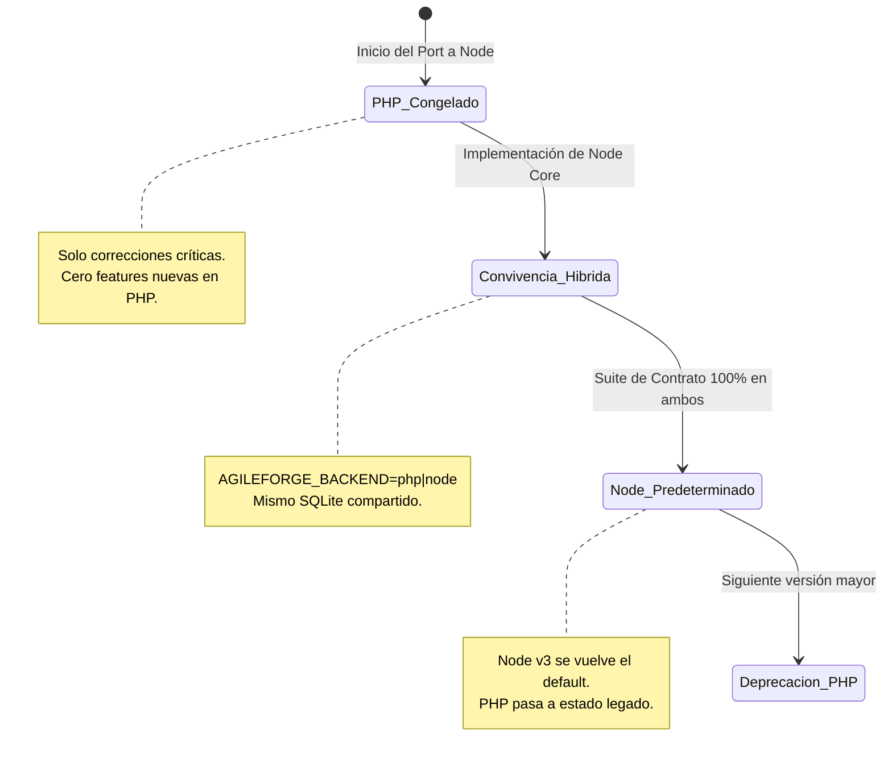

# RFC-002: Repositorio Autoinstalable y Migración del Núcleo a Node.js

- **Estado:** Propuesta Aprobada (Diseño - Fase B)
- **Fecha:** 2026-11-09
- **Autores:** David & Equipo de Arquitectura AgileForge
- **Referencia:** ADR-001, ADR-002, ADR-004, RFC-001

---

## 1. Visión y Objetivo

**Meta principal:** Permitir que cualquier desarrollador o asistente de inteligencia artificial (Claude Code, Cursor, Codex, Gemini Code Assist) clone el repositorio y establezca un entorno 100% operativo ejecutando un único comando o consultando una sola guía canónica, con cero ambigüedad y sin improvisación.

Adicionalmente, se define la **unificación total del backend en Node.js**, erradicando la dependencia de PHP/Apache/XAMPP para consolidar una única plataforma de ejecución compartida con el servidor MCP.

---

## 2. Experiencia de Autoinstalación Universal

### 2.1 Enrutamiento de Guías: Una Única Fuente de Verdad

```
                    ┌────────────────────────┐
                    │      INSTALL.md        │
                    │ (Única fuente canónica:│
                    │  paso a paso, comandos │
                    │   exactos e idempotente)│
                    └───────────▲────────────┘
                                │
        ┌───────────────────────┼────────────────────────┐
        │                       │                        │
┌───────┴────────┐      ┌───────┴────────┐      ┌────────┴────────┐
│   CLAUDE.md    │      │   AGENTS.md    │      │    README.md    │
│  (Claude Code) │      │ (Codex/Cursor/ │      │ (Personas y     │
│                │      │    Gemini)     │      │  bloque rápido) │
└────────────────┘      └────────────────┘      └─────────────────┘
```

- **`INSTALL.md`:** Especificación paso a paso de prerrequisitos, variables de entorno, arranque de servicios y verificación de salud.
- **`CLAUDE.md` y `AGENTS.md`:** Instrucción estricta para asistentes de código:
  > *"Para instalar o configurar este proyecto, NO improvises comandos ni uses herramientas externas no especificadas. Lee y ejecuta estrictamente las instrucciones de `INSTALL.md`."*
- **Bloque en `README.md` ("Copia esto a tu IA"):**
  ```markdown
  ### 🤖 Instalación Asistida por IA
  Copia y pega este mensaje en tu asistente (Claude Code, Cursor, Codex o Gemini):
  > "Configura el entorno de desarrollo de AgileForge siguiendo estrictamente la guía `INSTALL.md`. Ejecuta la instalación, corre el diagnóstico con `npm run doctor` y confírmame cuando el servidor y el MCP estén listos para operar."
  ```

### 2.2 Un Solo Comando de Instalación Idempotente

El proceso de preparación se unifica en un comando determinista multiplataforma:

```bash
npm run setup
```
*(Invoca `node bin/setup.mjs`, compatible de forma nativa con Windows PowerShell, macOS y Linux).*

**Operaciones que realiza:**
1. Valida el runtime de Node.js (**mínimo Node.js 22.13.0**; recomienda la última versión LTS).
2. Genera `.env` a partir de `.env.example` si no existe.
3. Genera tokens criptográficamente seguros (`AGILEFORGE_API_TOKEN`, `AGILEFORGE_VIEW_TOKEN`) si están vacíos.
4. Crea la estructura de almacenamiento local (`data/`, `data/backup/`).
5. Instala dependencias en raíz y en `mcp-server/`.
6. Compila TypeScript y construye los bundles de plugin MCP (`npm run build && npm run bundle`).
7. Inicializa el esquema de SQLite asegurando idempotencia.

### 2.3 Un Solo Diagnóstico (`doctor`) en Node.js desde la Fase 2.1

> [!IMPORTANT]
> **Decisión de Arquitectura (David):**
> Existe **un único comando `doctor` escrito en Node.js** (`bin/doctor.mjs` o `npm run doctor`) desde la fase 2.1. No habrá duplicidad de comandos en PHP y Node. El doctor de Node se encarga de auditar el entorno completo, incluyendo la disponibilidad y extensiones de PHP mientras persista la fase de transición híbrida.

```bash
npm run doctor
```

**Verificaciones de salud ejecutadas:**
- [x] **Runtime Node.js:** Verifica `>= 22.13.0` y advierte si no se utiliza la LTS recomendada.
- [x] **PHP (durante convivencia híbrida):** Versión `>= 8.2`, extensiones `pdo_sqlite`, `mbstring`, `curl`.
- [x] **Integridad SQLite:** Permisos de lectura/escritura en `data/agileforge.sqlite`, pragmas WAL y timeout configurados.
- [x] **Servidor MCP:** Presencia de bundles en `mcp-server/dist/index.js`, verificación de inicio por stdio.
- [x] **Tokens y Seguridad:**
  - Token de API: `Configurado (64 chars; origen: .env)` — **NUNCA imprime el valor del token**.
  - Token de Vista: `Configurado (64 chars; origen: .env)`.
- [x] **Conectividad de Proveedores IA:** Estado de claves configuradas en `.env` (Anthropic, OpenAI, Gemini, DeepSeek) y estado de IA Local (Ollama/Colibri).

---

## 3. Especificación del Núcleo Node.js v3

### 3.1 Requisitos de Runtime y `node:sqlite`

> [!IMPORTANT]
> **Decisión de Arquitectura (David):**
> - **Versión mínima obligatoria:** **Node.js 22.13.0** (versión a partir de la cual `node:sqlite` está disponible sin requerir flags de CLI como `--experimental-sqlite`).
> - **Recomendación del Doctor:** Recomienda siempre la versión LTS activa más reciente de Node.js.
> - **Fin de Soporte para Node 18 y 20:** Ambas versiones han alcanzado su fin de vida (EOL) o carecen del módulo nativo estable; quedan terminantemente excluidas.
> - **Sin Driver de Respaldo:** **No se utilizará `better-sqlite3` ni fallbacks nativos.** Esto elimina por completo la necesidad de compilar dependencias C++ con `node-gyp` o Visual Studio Build Tools en Windows.

#### Consideraciones sobre el Estado de `node:sqlite`:
- `node:sqlite` expone la clase síncrona `DatabaseSync`, mapeada directamente sobre la biblioteca C de SQLite 3.
- Actualmente se encuentra catalogado como *Stability: 1.1 (Release Candidate)* por el equipo de Node.js.
- Existen diferencias menores de API entre revisiones de Node 22 (tales como la disponibilidad de métodos para transacciones o propiedades en `statement.run()`). La capa de acceso a datos de AgileForge (`src/core/storage/sqlite-driver.ts`) abstraerá estas peculiaridades garantizando compatibilidad homogénea a partir de Node 22.13.0.

---

### 3.2 Concurrencia Multiproceso en SQLite (WAL + BEGIN IMMEDIATE)

En el flujo de trabajo de AgileForge, conviven múltiples procesos concurrentes escribiendo en el mismo archivo `data/agileforge.sqlite`:
- Sesiones concurrentes de Claude Code vía MCP.
- Adaptadores de IDE (Cursor, Codex, Gemini).
- El panel web local realizando consultas o actualizaciones de estado.

Para erradicar definitivamente errores de bloqueo (`database is locked` / `SQLITE_BUSY`), el backend en Node implementa la siguiente política obligatoria:

```typescript
// src/core/storage/database.ts
import { DatabaseSync } from 'node:sqlite';

export function createDatabaseConnection(dbPath: string): DatabaseSync {
  const db = new DatabaseSync(dbPath);
  
  // 1. Espera activa de hasta 10 segundos ante bloqueos concurrentes
  db.exec('PRAGMA busy_timeout = 10000;');
  
  // 2. Modo Write-Ahead Logging para permitir lecturas concurrentes sin bloquear escrituras
  db.exec('PRAGMA journal_mode = WAL;');
  
  // 3. Sincronización normal optimizada para WAL
  db.exec('PRAGMA synchronous = NORMAL;');
  
  // 4. Claves foráneas activadas
  db.exec('PRAGMA foreign_keys = ON;');
  
  return db;
}

// 5. Transacciones de escritura obligatoriamente con BEGIN IMMEDIATE
export function transaction<T>(db: DatabaseSync, fn: () => T): T {
  db.exec('BEGIN IMMEDIATE;');
  try {
    const result = fn();
    db.exec('COMMIT;');
    return result;
  } catch (error) {
    db.exec('ROLLBACK;');
    throw error;
  }
}
```

> [!NOTE]
> `BEGIN IMMEDIATE` asegura que la transacción adquiere el bloqueo de reserva desde el primer instante, impidiendo que dos transacciones inicien en modo lectura compartida y fallen luego con `SQLITE_BUSY` al intentar promoverse a escritura.

---

### 3.3 Panel Web Seguro en Node.js y MCP In-Process

1. **Panel Web Local Restringido a 127.0.0.1:**
   - El servidor HTTP embebido (Fastify) escucha **exclusivamente en `127.0.0.1`**, nunca en `0.0.0.0`. Esto previene accesos no autorizados a través de interfaces de red local.
2. **Autenticación Obligatoria en Navegador:**
   - Toda petición HTTP a los endpoints de la API (`/api/*`) exige la cabecera `Authorization: Bearer <AGILEFORGE_API_TOKEN>`.
   - La página web almacena el token en memoria o `sessionStorage` tras su autenticación inicial.
3. **MCP In-Process (Direct Storage Access):**
   - El servidor MCP comunicado por `stdio` con Claude Code se ejecuta en el mismo proceso de Node.
   - Las herramientas de lectura y escritura (`read.ts`, `write.ts`) llaman directamente a los repositorios locales en disco/memoria. **No realizan peticiones HTTP locales por loopback ni requieren token**, reduciendo la latencia a 0 ms.

---

## 4. Estimación Detallada del Port a Node.js

Para formular un cronograma riguroso, se analiza el esfuerzo de migración de cada componente funcional:

| Módulo / Controlador PHP | Responsabilidad y Complejidad Técnica | Estimación |
|---|---|---|
| **Capa de Persistencia y Concurrencia** (`Repository`, `Database`, `StorageDriverInterface`) | Mapeo de consultas, migraciones idempotentes, `DatabaseSync`, transacciones con `BEGIN IMMEDIATE`, `busy_timeout`. | 3 días |
| **DirectorService (Bucle Agéntico)** | Bucle multi-turn de herramientas del Director, llamadas iterativas con Anthropic SDK, parsing de intenciones y acciones sobre el tablero. | 4 días |
| **Reuniones Ágiles** (`MeetingController`, `MeetingService`) | Moderación de rondas de turnos entre roles con motor asignado, síntesis de actas, registro de decisiones ADR. | 2.5 días |
| **Configuraciones y Documentos Legales** (`SettingController`) | Generación dinámica de avisos de privacidad y términos por jurisdicción (Perú, UE, USA, etc.), lectura/escritura atómica de `.env`. | 2 días |
| **Integración Git** (`ProjectController`) | Extracción de historial, ramas y autores mediante ejecución asíncrona de `git log` con `child_process`. | 2 días |
| **Control de IA Local** (`LocalAiService`) | Detección de procesos Colibri / Ollama en Windows mediante PowerShell y scripts CLI, comprobación de puertos y modelos activos. | 2.5 días |
| **Conversión de `index.php` a Estático** | Transformación de la vista PHP a `index.html` estático con inyección segura de token de sesión y configuración en tiempo de arranque. | 2 días |
| **Endpoints REST y Web Server (Fastify)** | Replicación exacta del contrato JSON de endpoints existentes para tablero, tareas, agentes, métricas y streaming SSE. | 3 días |
| **Pruebas de Paridad y Validación Cruzada** | Ejecución de la suite de pruebas de contrato contra ambos backends (`php` y `node`). | 3 días |
| **Total Estimado** | | **24 días hábiles** |

---

## 5. Estrategia de Transición y Coexistencia

> [!IMPORTANT]
> **Decisión de Arquitectura (David):**
> 1. **Interruptor de Entorno:** Durante una versión menor completa, el sistema admite alternar entre backends mediante la variable `AGILEFORGE_BACKEND=php|node` en `.env`.
> 2. **Criterio de Cambio Definitivo:** El backend de Node solo pasará a ser el predeterminado cuando la suite de pruebas de contrato (desarrollada por Claude en `tests/`) **pase con 100% de éxito en ambos backends**.
> 3. **Congelamiento de PHP:** A partir de que comience el trabajo de port a Node, el código de `api/` en PHP queda estrictamente congelado: **únicamente se admitirán correcciones críticas de bugs**. Ninguna funcionalidad nueva se programará en PHP.



---

## 6. Orden Final de Trabajo

El flujo secuencial de desarrollo acordado para garantizar estabilidad continua es el siguiente:

```
┌────────────────────────────────────────────────────────────────────────┐
│ 1. Correcciones Críticas en feat/memoria-nodular                        │
│    (Locks UTC, validación DoD git, memoria por proyecto, budget sprint)│
│    [ESTADO: COMPLETADO ✓]                                              │
└───────────────────────────────────┬────────────────────────────────────┘
                                    │
┌───────────────────────────────────▼────────────────────────────────────┐
│ 2. Pruebas de Contrato y CI (Claude en tests/ y .github/ci.yml)        │
│    Blindaje de la API actual antes de cualquier cambio estructural.    │
└───────────────────────────────────┬────────────────────────────────────┘
                                    │
┌───────────────────────────────────▼────────────────────────────────────┐
│ 3. Repo Autoinstalable (INSTALL.md, AGENTS.md, CLAUDE.md, doctor Node) │
│    Un solo comando `npm run doctor` en Node que valida Node y PHP.     │
└───────────────────────────────────┬────────────────────────────────────┘
                                    │
┌───────────────────────────────────▼────────────────────────────────────┐
│ 4. Registro de Roles en Archivos con Capacidades (sobre PHP)           │
│    Desacoplamiento de roles duros hacia roles/<id>.md en el repo actual.│
└───────────────────────────────────┬────────────────────────────────────┘
                                    │
┌───────────────────────────────────▼────────────────────────────────────┐
│ 5. Núcleo Node.js v3 (Node 22.13+, node:sqlite, Fastify, MCP in-process│
│    Port completo del backend con interruptor AGILEFORGE_BACKEND.       │
└───────────────────────────────────┬────────────────────────────────────┘
                                    │
┌───────────────────────────────────▼────────────────────────────────────┐
│ 6. Forja de Agentes v1 (Forjar, Templar con sandbox aislado, Armería)  │
│    Ciclo completo montado nativamente sobre el núcleo Node unificado.  │
└────────────────────────────────────────────────────────────────────────┘
```
